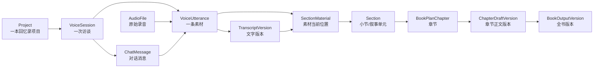
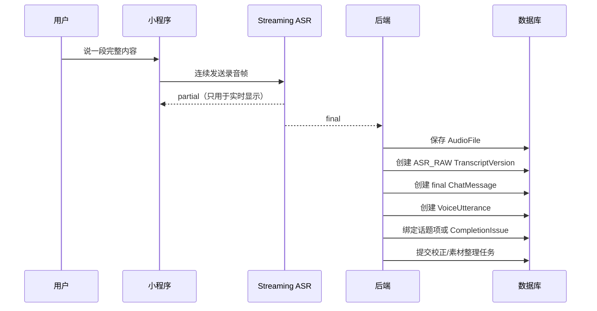
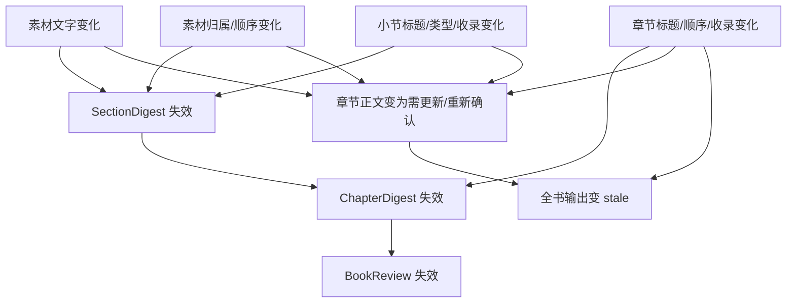

# 回忆录重要数据结构、来源、展示与编辑指南

## 文档定位

本文基于当前仓库中的数据库模型、API schema、领域服务和小程序页面，回答四个问题：

1. 回忆录目前有哪些重要数据结构；
2. 这些数据从哪里来，经过怎样的流转；
3. 这些数据在产品中怎样使用和展示；
4. 用户修改不同数据时，应该修改哪一层，以及会影响什么。

本文描述的是当前实现，不是脱离代码的目标模型。更上层的不变量以主架构文档为准：

最后核对日期：2026-08-30。

- `MEMOIR_INTERVIEW_AND_BOOK_ARCHITECTURE.md`：事实来源、素材归属、主题讲述、成书、缓存和请求边界；
- `MEMOIR_VOICE_CHAT_ARCHITECTURE.md`：实时录音、ASR、对话和 TTS；

主要实现入口：

- 数据库模型：`backend/app/models/memoir.py`、`backend/app/models/memoir_narrative/`
- API schema：`backend/app/schemas/` 下的 `memoir_*.py`
- 素材与小节：`backend/app/services/memoir/material_organization.py`、`sections.py`
- 章节与正文：`backend/app/services/memoir/book_plan_write_workflow.py`、`chapter_generation.py`
- 全书组装：`backend/app/services/memoir/narrative/book_output_assembly.py`
- 小程序页面：`miniprogram/pages/transcripts/`、`transcript-detail/`、`book/`、`chapter-workspace/`、`book-reader/`

---

## 一、先建立一个统一心智模型

### 1.1 主数据链



最重要的理解是：

- `VoiceUtterance` 是规范的“素材”实体；
- `SectionMaterial` 不是第二份素材，而是素材当前归属、顺序和采用文字版本的关系；
- `Section` 是小节，也是最小的可独立理解的叙事单元；
- `BookPlanChapter` 是目录里的章节；
- `ChapterDraftVersion` 是根据小节和素材生成、人工修改后的正文；
- `BookOutputVersion` 是把可读章节正文组装成的全书快照，章节确认是独立的用户操作。

### 1.2 四层数据，不要混在一起

| 层级 | 代表数据 | 回答的问题 | 是否是事实来源 |
| --- | --- | --- | --- |
| 原始资产与事实层 | AudioFile、VoiceUtterance、TranscriptVersion | 用户当时说了什么，有什么原始证据 | 是 |
| 结构组织层 | SectionMaterial、Section、BookPlanChapter | 这段讲述放在哪里，以什么顺序成书 | 否，但它是当前结构真相 |
| 编辑正文层 | ChapterDraft、ChapterDraftVersion | 这些素材如何整理成可读正文 | 否 |
| 出版输出层 | BookOutput、BookOutputVersion、Manuscript、ImagePlacement | 如何形成一本可阅读、朗读、导出的书 | 否 |

另有两类辅助数据：

- 语义审阅数据：SectionDigest、ChapterDigest、BookReview、CompletionIssue；
- 运行与展示数据：EditingJob、AutomationEvent、项目快照、客户端缓存。

### 1.3 当前真相的唯一归属

| 概念 | 当前真相 |
| --- | --- |
| 原始录音 | `audio_files` |
| 一次完整讲述/回答 | `memoir_voice_utterances` |
| 识别原文、自动校正、人工修改历史 | `memoir_transcript_versions` |
| 当前用于展示和成书的素材文字 | 素材当前 `transcript_edited`，并由 `SectionMaterial.transcript_version_id` 锁定入书版本 |
| 素材当前在哪个小节 | `memoir_section_materials` |
| 小节当前在哪一章、顺序和收录状态 | `memoir_sections` |
| 当前章节规划 | `memoir_book_plans` + `memoir_book_plan_chapters` |
| 当前章节正文 | 该章最新 `memoir_book_chapter_draft_versions` |
| 当前全书 | 最新 `memoir_book_output_versions` |

特别注意：API 中的章节 `source_refs` 是为了展示和兼容生成的读模型。它当前是从 Chapter → Section → SectionMaterial → VoiceUtterance 反向计算出来的，不是一套独立持久化的素材归章真相。

---

## 二、项目与访谈上下文

### 2.1 Project：一本回忆录的根

物理表：`projects`

重要字段：

| 字段 | 作用 |
| --- | --- |
| `id` | 项目边界，所有回忆录业务数据都应能回到它 |
| `user_id` | 所有权与跨用户隔离 |
| `type` | 当前产品类型，回忆录项目应为 memoir |
| `title` | 用户设置的回忆录名称，也是当前书名的唯一真相 |
| `description` | 项目级介绍信息 |
| `metadata_json` | 方言、AI 模型偏好等非核心扩展信息 |
| `memoir_data_revision` | 迁移前的项目版本基线；新变更读取追加式 revision event |

来源：

- 用户创建回忆录项目；
- 用户编辑项目名称、介绍或回忆录人物资料。

用途与展示：

- 首页、书稿、讲述记录等页面的作用域；
- 首页、封面、阅读和导出逐字使用当前 `Project.title`，不能自动润色、补词或用副标题替换；
- 服务端聚合快照和客户端缓存的作用域；
- 权限校验和项目删除的根边界。

编辑原则：

- 项目资料可以修改；
- `memoir_data_revision` 是迁移前的版本基线；当前服务端通过
  `memoir_project_revision_events` 为每个发生业务可见变更的事务追加一个单调版本，
  不再回写 `projects` 行；
- `memoir_editing_jobs` 的领取、心跳、进度和结束状态不属于内容版本，不能推进内容 revision；
- `metadata_json` 只能承载扩展配置，不能替代素材、小节、章节等核心模型。

事务与加锁约束：

- 后台任务遵循“读取快照 → 提交并释放事务 → 调用外部模型 → 按稳定顺序加行锁并复核 → 短事务写回”；
- 禁止在持有数据库写锁时等待 LLM、ASR、Embedding、图片生成或其他网络调用；
- 同一事务锁多条素材时按稳定 ID 顺序获取；修改讲述文字时先锁
  `memoir_voice_utterances`，再锁对应 `memoir_chat_messages`；
- 任务表只承担调度和租约，不得通过触发器把任务心跳变成项目级内容锁。

### 2.2 VoiceSession：一次访谈

物理表：`memoir_voice_sessions`

一条 VoiceSession 表示一次从开始到结束的访谈，而不是一条素材。

重要字段：

| 字段 | 作用 |
| --- | --- |
| `status` | `created / listening / speaking / stopped / failed` |
| `guidance_mode` | `free_narration / guided_interview`，表示引导强度 |
| `interview_type` | `ai_interview / human_interview` |
| `session_goal` | `open_narration / book_completion`，表示本次业务目标 |
| `current_completion_issue_id` | 成书补讲时绑定的唯一当前问题 |
| `anchor_framework_item_id` | 从话题地图发起主题讲述时的锚点 |
| `current_guidance_module` | 当前引导模块 |
| `provider`、`input_format` | 语音 provider 和音频输入信息 |
| `started_at`、`stopped_at` | 会话生命周期 |

来源：

- 用户从自由讲述、话题地图或章节补全入口开始一次语音访谈。

用途与展示：

- 恢复一次未完成的访谈；
- 判断素材来自 AI 访谈还是人工采访；
- 区分普通讲述和为某个成书问题补讲；
- 在讲述记录中展示访谈时间、模式和上下文。

可编辑性：

- 生命周期由语音状态机维护；
- 用户可以停止会话；
- 会话目标、当前问题和话题锚点不应在会话进行中被随意改写。

### 2.3 ChatMessage：访谈里的对话消息

物理表：`memoir_chat_messages`

重要字段：

| 字段 | 作用 |
| --- | --- |
| `role` | `user / assistant / interviewer / system` |
| `content_text` | 当前消息文字 |
| `content_status` | `partial / final / corrected` |
| `audio_file_id` | 消息关联语音 |
| `transcript_version_id` | 当前消息对应的文字版本 |
| `parent_message_id` | 回答所对应的问题 |
| `guidance_intent` | AI 追问或引导意图 |
| `turn_index` | 会话内顺序 |

它解决“这段话在对话中扮演什么角色”。素材本身仍由 VoiceUtterance 表示。

当前还支持访谈整理：

- 修改采访者问题文字；
- 调整回答属于哪个问题；
- 将误判为问题的消息改回回答；
- 保留这些修正的来源与时间。

---

## 三、素材：VoiceUtterance 及其证据链

### 3.1 VoiceUtterance 是什么

物理表：`memoir_voice_utterances`

产品名称建议统一使用“讲述素材”或“讲述记录”。代码中的 canonical Material 就是 VoiceUtterance。

一条 VoiceUtterance 表示一次完整的用户讲述或回答。系统不在这一层把一句回答拆成多个事实卡片，也不允许把同一条素材复制到多个小节。

重要字段：

| 字段 | 作用 |
| --- | --- |
| `id` | 素材 ID，也是正文 allowlist 使用的 material ID |
| `voice_session_id` | 来自哪一次访谈 |
| `chat_message_id` | 对话中的对应消息 |
| `audio_file_id` | 原始音频 |
| `transcript_raw` | 首次 ASR 原文 |
| `transcript_edited` | 当前校正或人工编辑文字；为空时回退 raw |
| `start_ms`、`end_ms` | 素材在音频中的时间范围 |
| `provider` | ASR 来源 |
| `provider_payload_json` | provider 原始或诊断 payload |
| `framework_item_id` | 与话题地图项的直接访谈锚点 |
| `completion_issue_id` | 这条回答是否来自成书补讲 |
| `policy_decision_id` | 产生这轮问题的访谈策略决策 |
| `created_at` | 讲述产生时间 |

### 3.2 素材是怎么来的

标准实时链路：



只有 provider final 或明确的恢复结果才创建正式素材。ASR partial 不作为事实落库。

当前还有以下来源：

- 未 final 但音频已保存：先创建只有音频、无文字的 VoiceUtterance，讲述记录页显示“等待转写”，用户可显式恢复；
- 人工采访模式：采访者和叙述者的语音都可落库，通过 ChatMessage role 区分；只有叙述者回答进入成书素材链；
- 问题误判修复：将采访者问题转换为回答后，现有 utterance 会重新作为叙述者素材进入整理；
- 成书补讲：仍创建普通 VoiceUtterance，只是额外绑定 `completion_issue_id`；
- 离线加强识别：不会创建第二条素材，而是为同一素材增加新的文字版本。

### 3.3 AudioFile：原始音频资产

物理表：`audio_files`

重要字段包括文件路径、MIME、字节数、时长和所有者。

用途：

- 讲述原音播放；
- ASR 失败后的显式恢复；
- 转写校对证据；
- 分享视频和音频时间对齐；
- 未来从正文回溯原始口述。

编辑原则：

- 原始音频不能因修改成书文字而覆盖；
- 删除素材是单独的破坏性动作，不应通过“隐藏”或“修改文字”间接删除音频证据；
- 所有音频访问必须校验用户和项目作用域。

### 3.4 TranscriptVersion：文字版本历史

物理表：`memoir_transcript_versions`

版本类型：

| `version_type` | 含义 | 常见创建者 |
| --- | --- | --- |
| `asr_raw` | provider 原始识别 | ASR |
| `dialect_corrected` | 方言、口语和识别错误校正 | AI / 系统 |
| `user_edited` | 用户人工或语音指令确认后的修改 | 用户 |
| `final` | 明确发布的最终版本能力 | 系统/用户，当前主流程较少直接依赖 |

重要字段：

| 字段 | 作用 |
| --- | --- |
| `source_artifact_id` | 指向 VoiceUtterance |
| `content` | 该版本完整文字 |
| `provider`、`confidence` | 版本来源与置信度 |
| `created_by` | `asr / ai / user / system` |
| `created_at` | 版本时间 |

当前使用规则：

- 列表和详情优先显示 `transcript_edited`，没有则显示 `transcript_raw`；
- 素材已经归入小节后，`SectionMaterial.transcript_version_id` 记录正文实际采用的文字版本；
- 用户编辑素材文字时会创建新 TranscriptVersion，并同步素材、小节引用和相关章节失效状态；
- 原始 `transcript_raw` 和原始录音不被覆盖。

### 3.5 TranscriptAlignment：文本与音频时间对齐

物理表：`memoir_transcript_alignments`

它保存文字 hash、对齐策略、置信度、音频总时长和分段位置，用于：

- 选取讲述文字时定位音频区间；
- 字幕高亮；
- 生成分享视频；
- 将正文来源回溯到具体音频片段。

它是可重新生成的技术派生数据，不是新的事实来源。

### 3.6 RetrievalEntry：素材的检索投影

物理表 `memoir_retrieval_entries` 是可重建的检索投影，不是新的事实来源。每条叙述者素材始终有一条 `source_text` 投影：优先索引校正或人工编辑文字，否则索引 ASR 原文；后台另用 DeepSeek Pro 从同一段文字生成零个或多个 `semantic_unit` 投影。语义单元不限制数量，不使用最近对话上下文，空结果表示原文之外不需要额外入口。两类投影都通过项目、会话、素材、文字版本和音频外键回到同一证据链。

该投影保存 512 维向量并维护使用 Jieba 分词的 BM25 索引。向量召回在项目范围内执行精确余弦距离排序；当前数据规模不建立 HNSW 近似索引。原文索引成功后才排入独立语义索引任务，因此 LLM 失败不会阻塞原文索引。文字校正或人工编辑后，旧语义投影立即失效，新任务按素材、文字版本和文字 hash 幂等重建；过期任务不能覆盖较新的文字。LLM 的决定、模型、耗时和用量记录在对应后台任务结果中。

历史数据默认只统计、不自动触发有成本的 LLM 调用。`scripts/backfill_memoir_retrieval_semantics.py` 不带参数时只返回符合条件的数量，只有显式传入 `--enqueue` 才会排入回填任务。

实时查询侧不再调用额外 LLM。系统直接把当前讲述原文作为唯一 Query，通过本地 embedding 和 PostgreSQL Vector/BM25/RRF 召回最多 12 个历史素材候选；长讲述先按自然句切块，再由本地 embedding 选出与本轮最相关的原文片段。按融合顺序、总计不超过 4000 字的候选原文直接进入原本就要调用的下一句追问 LLM，由该模型同时判断候选是否相关并生成回应。不相关候选必须忽略，不注入索引文字、LLM 改写摘要或内部检索信息。

物理表 `memoir_memory_activation_traces` 保存每次激活的完整调试轨迹，包括当前原文 Query、Vector/BM25 命中、RRF 候选、实际送入下一句追问 LLM 的原文以及失败诊断，但不保存向量本身。重复生成同一条用户消息的回应时复用已成功或已跳过的轨迹，避免重复本地检索。调试 API 的列表只返回摘要，单条详情才返回完整 trace。由于不再单独调用选择模型，日志只表达哪些候选被送入最终提示词，不声称最终回答一定使用了某条候选。

旧的“跨会话最近 8 条用户消息”不再直接进入提示词。新会话开场只保留“该项目是否已有同模式讲述”的布尔状态，不读取具体历史内容；有当前讲述时，跨会话事实必须经过上述检索和激活流程才能进入下一问。

### 3.7 素材当前如何展示

当前小程序已有两个主要层级。

讲述记录页 `miniprogram/pages/transcripts/`：

- 按时间展示素材卡片；
- 显示摘要标题、摘要预览、访谈时间和成书收录状态；
- 支持文本搜索和语音搜索；
- 可筛选、分页；
- 对只有音频没有文字的素材显示恢复转写入口。

讲述详情页 `miniprogram/pages/transcript-detail/`：

- 播放讲述原音；
- 显示“成书文字”和“原始讲述”；
- 显示当时回答的问题及问题音频；
- 显示当前章节和小节位置；
- 显示离线加强识别状态；
- 支持制作带字幕高亮的分享视频；
- 将低频、破坏性操作收在“更多操作”。

推荐保持的素材卡信息优先级：

1. 可读摘要或首段预览；
2. 产生时间与访谈类型；
3. 是否已有文字、是否可播放原音；
4. 当前章节/小节位置；
5. 是否收录入书；
6. 编辑和更多操作。

内部的 provider payload、TranscriptVersion ID、confidence 不应默认暴露给普通用户，可放在诊断或来源详情中。

### 3.8 素材当前如何编辑

当前小程序已支持：

- 手动修改成书文字；
- 在同一编辑模式中切换查看修改前、修改后文字；
- 查看原始讲述作为编辑参考；
- 恢复成书文字为原始讲述；
- 用语音说修改要求，直接生成修改后草稿，再与修改前对比并统一保存；
- 启动离线加强识别；
- 调整素材所在章节和小节；
- 将误判的问题改成回答；
- 删除整条讲述。

素材修改保持轻量，不复用章节或全书修改的“修改思路、候选稿、迭代反馈”任务流程。语音修改和手动修改共同维护一份本地草稿，只有最终保存动作会创建新的文字版本。

编辑影响：

| 操作 | 修改的数据 | 不修改的数据 | 后续影响 |
| --- | --- | --- | --- |
| 修改成书文字 | 新 TranscriptVersion、`transcript_edited`、当前引用版本 | 原始音频、`transcript_raw` | 相关摘要/正文需要重新计算或重新确认 |
| 移动素材 | SectionMaterial 的 `section_id` 和顺序 | VoiceUtterance、录音、文字历史 | 原/目标小节版本增加，相关 Digest 和正文失效 |
| 不收入书 | SectionMaterial `include_in_book` | 原始素材 | 后续生成 allowlist 排除它 |
| 删除素材 | 删除或清理素材及关联结构 | 已生成的旧正文快照不会被偷偷重写 | 相关章节标记需重新确认 |
| 恢复转写 | 给同一 VoiceUtterance 补 ChatMessage 和 TranscriptVersion | 原始音频 | 素材变为可搜索、可整理状态 |

---

## 四、素材归属：SectionMaterial

### 4.1 它为什么是关键关系

物理表：`memoir_section_materials`

SectionMaterial 解决的不是“素材是什么”，而是：

- 这条素材现在属于哪个小节；
- 在小节中的顺序；
- 正文应该采用哪个文字版本；
- 谁做了归类；
- 是否收录进书。

重要字段：

| 字段 | 作用 |
| --- | --- |
| `section_id` | 当前所属小节 |
| `utterance_id` | 原始素材 |
| `transcript_version_id` | 当前成书采用的文字版本 |
| `sort_order` | 小节内顺序 |
| `assigned_by` | `ai / user / system` |
| `assignment_confidence` | AI 归类置信度 |
| `assignment_reason` | 归类理由或来源 |
| `include_in_book` | 这条素材是否参与正文生成 |

数据库保证同一项目的一条 utterance 只有一个 SectionMaterial，因此同一素材不能同时出现在多个小节。

### 4.2 它是怎么来的

有三条主要路径：

1. 生成或确认章节规划时，系统根据章节来源把每条素材放入相应章节的第一个默认小节；
2. 已有确认规划后，新素材校正完成会触发素材整理任务：
   - 放入已有小节；
   - 现有小节都不合适时，放入最相关章节的“待归类素材”；
3. 用户在讲述详情或章节工作台手动移动素材。

章节 API 返回的 `source_refs`、素材详情中的 `included_chapters` 和 `section_assignment` 都是从这条关系计算出来的读模型。

### 4.3 展示建议

面向用户展示：

- “第几章：章节名”；
- “小节几：小节名”；
- 未归类时明确显示“待归类素材”；
- 是否收入正文；
- 如果是系统低置信度归类，展示“请确认位置”，不要展示浮点 confidence。

面向编辑者或后台可额外展示：

- assigned_by；
- assignment_reason；
- 采用的 TranscriptVersion；
- 归类前后历史。

当前模型只保存当前归属，没有独立的移动历史表。若未来需要审计结构演进，应新增显式事件历史，不要把历史塞进 `metadata_json`。

---

## 五、小节：Section

### 5.1 Section 是什么

物理表：`memoir_sections`

产品中可以称“小节”或“小章节”。本文统一称“小节”。

一个 Section 应能相对独立地被理解，例如一个故事、一个人物片段、一个人生阶段或一段观点。它属于且只属于一个 Chapter。

当前支持的类型：

| `section_type` | 产品含义 | 审阅重点 |
| --- | --- | --- |
| `event` | 具体事件 | 背景、发展、转折、影响 |
| `life_fragment` | 生活片段 | 场景、感受、片段自身完整性 |
| `person_portrait` | 人物描写 | 关系、特点、为何重要 |
| `life_stage_summary` | 人生阶段概述 | 主要变化、代表经历、回看 |
| `viewpoint_reflection` | 观点与反思 | 观点来源、表达、经历联系 |

重要字段：

| 字段 | 作用 |
| --- | --- |
| `chapter_id` | 所属章节 |
| `title` | 小节标题 |
| `section_type` | 叙事类型 |
| `sort_order` | 章内顺序 |
| `status` | `active / archived` |
| `include_in_book` | 整个小节是否参与成书 |
| `version` | 结构并发控制和派生结果失效依据 |
| `metadata_json` | 系统角色、生成来源等扩展信息 |

### 5.2 小节是怎么来的

当前有三种来源：

- 生成、保存或确认章节规划：每章至少创建一个默认小节，初始标题通常等于章节标题；
- 章节工作台“重新整理小节分组”：AI 基于本章全部素材重新生成整套小节；
- 后端结构 API：用户或管理端显式创建、拆分小节。

重新生成小节分组时：

- 服务端校验用户看到的 Section version，防止覆盖并发修改；
- LLM 调用完成后再次校验素材和版本；
- 在事务内替换该章旧小节结构；
- 无法可靠归类的素材进入一个特殊的“待归类素材”小节；
- 该特殊小节 `include_in_book = false`，并通过 `metadata_json.system_role` 标记，不能直接生成正文。

### 5.3 小节如何使用

Section 同时服务于：

- 组织素材和控制素材顺序；
- 生成 SectionDigest；
- 生成章节正文时划定每个小节独立的 Material allowlist；
- 在章节工作台按小节展示素材；
- 在章节正文中保存分小节内容；
- 在全书目录和阅读页展示二级目录。

正文生成时，每个小节只能使用自己的素材。其他小节正文不会被当作事实输入，避免跨小节重复和派生正文污染事实。
为保证相邻小节自然衔接，生成下一小节时会把较短的上一小节正文作为衔接参考；上一小节较长时只传其现有摘要、重点和人物/地点/事件等关键要素。该参考只用于衔接和去重，不能成为下一小节新增事实的来源。

### 5.4 小节当前如何展示

章节工作台当前分成两个不同区域：

1. “素材分组”：展示 Section 结构和每个 Section 下的原始讲述；
2. “本章正文”：展示 `ChapterDraftVersion.section_snapshot_json` 中的小节正文。

这两个区域看起来都叫“小节”，但含义不同：

- 前者是结构层 Section；
- 后者是某次正文版本里的 Section 快照。

推荐 Section 卡片展示：

- 小节序号、标题、类型；
- 素材条数与收录条数；
- 一至两条素材预览；
- 是否待用户归类；
- 是否收入书稿；
- 当前正文状态：未生成、需更新、可阅读、已确认。

### 5.5 小节当前如何编辑

当前小程序已支持：

- 对一章重新生成整套小节分组；
- 把“待归类素材”移动到目标小节；
- 在讲述详情中把任意素材移动到已有小节；
- 对已经生成的小节正文进行手动编辑；
- 用文字或语音指令让 AI 只修改当前小节正文。

后端 API 已支持、但当前小程序没有完整暴露为常规交互：

- 新建小节；
- 修改小节标题、类型、状态和 `include_in_book`；
- 小节排序；
- 合并小节；
- 拆分小节；
- 批量分配素材。

需要明确区分两类编辑：

| 用户意图 | 应修改的层 |
| --- | --- |
| “这段话应该放到另一个故事里” | SectionMaterial |
| “这两个故事其实是一个” | Section 合并 |
| “这个小节标题不合适” | Section.title |
| “这个小节不要收入书” | Section.include_in_book |
| “这段正文写得不够自然” | ChapterDraftVersion 的该小节 content |
| “原话识别错了” | TranscriptVersion / VoiceUtterance |

不要通过修改正文来掩盖素材归类错误，也不要通过修改素材原文来实现文章润色。

---

## 六、章节规划与章节：BookPlan / BookPlanChapter

### 6.1 BookPlan

物理表：`memoir_book_plans`

一个项目当前只允许一个 BookPlan。它表示“这本书准备怎样分章”。

重要字段：

| 字段 | 作用 |
| --- | --- |
| `title` | 章节规划/目录名称 |
| `status` | `draft / confirmed` |
| `created_by` | `ai / user / system` |
| `model` | AI 规划使用的模型 |
| `prompt_snapshot` | 当时规划 prompt，供审计和复现 |
| `metadata_json` | 输入素材数、确认来源等 |

### 6.2 BookPlanChapter

物理表：`memoir_book_plan_chapters`

重要字段：

| 字段 | 作用 |
| --- | --- |
| `plan_id` | 所属规划 |
| `project_id` | 权限和跨项目约束 |
| `title` | 章节标题 |
| `sort_order` | 全书顺序 |
| `include_in_book` | 是否进入最终全书 |
| `metadata_json` | 结构修改、来源变化等扩展状态 |

Chapter 自身不保存正文，也不直接保存规范的 source_refs。它通过 Section 获得素材，通过 ChapterDraft 获得正文。

### 6.3 章节是怎么来的

初次生成：

1. 收集当前项目中可用的叙述者素材；
2. 为每条素材构造带 utterance、message、audio、time range 和文字的 SourceSegment；
3. LLM 只基于这些素材返回章节标题和 source index；
4. 服务端校验来源必须属于当前项目、每章至少有一条来源；
5. 保存 draft BookPlan，并把来源同步到每章的默认 Section 和 SectionMaterial；
6. 用户调整并确认后，保存 confirmed plan；
7. 确认时再次通过 `sync_materials_to_chapters` 将最终章节来源同步到唯一的 SectionMaterial 归属表。

确认后新增素材：

- 校正完成后提交 `organize_material` 任务；
- AI 判断素材应放入哪个已有小节；现有小节都不合适时，放入最相关章节的“待归类素材”，由用户确认归属；
- 相关章节记录“有新素材/有补讲素材待更新”，已有正文不会静默改写。

### 6.4 章节当前如何展示

书稿页 `miniprogram/pages/book/`：

- 没有规划时展示“从讲述记录生成章节”；
- 规划草稿阶段展示目录名称、每章标题、来源条数和来源预览；
- 确认后展示每章成稿状态、来源变化和主要操作；
- “书稿”统一承接章节工作台、全书补全、阅读和导出入口；首页不再绕过书稿页直达补全流程。
- 全书生成后优先进入专用阅读页；文件导出和成书设置进入同一个输出中心。

全书补全页 `miniprogram/pages/book-completion/`：

- 每章展示一个读模型状态：
  - `not_started`
  - `preparing`
  - `needs_input`
  - `draft_ready`
  - `confirmed`
  - `failed`
- 每章只给出一个当前下一步。

章节工作台 `miniprogram/pages/chapter-workspace/`：

- 同时展示素材分组、待归类素材、当前补全问题和章节正文；
- 是结构整理和正文编辑的主要工作区。

### 6.5 章节当前如何编辑

当前小程序已支持：

- 修改章节标题；
- 让 AI 基于本章全部来源重新起名；
- 上移、下移章节；
- 合并章节；
- 选择部分素材拆出新章节；
- 删除章节但保留讲述；
- 设置章节是否收入本书；
- 重新规划整本书；
- 确认章节规划。

后端结构命令类型当前包括：

- `rename_chapter`
- `move_chapter`
- `merge_chapters`
- `split_chapter`
- `delete_chapter`
- `set_chapter_book_inclusion`

结构编辑的基本规则：

- 删除章节不等于删除原始素材；
- 合并、拆分、移动后，规范变化应落在 Chapter / Section / SectionMaterial；
- 已有章节正文需要标记为待更新或重新确认；
- 已有全书输出需要标记 stale，而不是原地偷偷改写；
- 至少保留一个收入本书的章节。

---

## 七、章节正文：ChapterDraft 与 ChapterDraftVersion

### 7.1 ChapterDraft 是状态容器

物理表：`memoir_book_chapter_drafts`

每个 Chapter 最多一个 ChapterDraft。

重要字段：

| 字段 | 作用 |
| --- | --- |
| `chapter_id` | 对应章节 |
| `status` | `draft / confirmed` |
| `metadata_json` | 素材变化、需要重写等状态原因 |

ChapterDraft 不直接保存正文。正文保存在不可变的 Version 中。

### 7.2 ChapterDraftVersion 是完整章节版本

物理表：`memoir_book_chapter_draft_versions`

重要字段：

| 字段 | 作用 |
| --- | --- |
| `version` | 章内递增版本 |
| `content` | 完整章节正文 |
| `created_by` | `ai / user / system` |
| `model` | 生成或 AI 修改所用模型 |
| `prompt_snapshot` | 生成输入审计 |
| `feedback` | 修改说明 |
| `input_signature` | 生成时的结构和素材签名 |
| `used_material_ids_json` | 正文实际使用的 Material |
| `material_snapshot_json` | Material、TranscriptVersion、文字 hash 和顺序快照 |
| `section_snapshot_json` | 每个小节标题、类型、版本、正文和 used Material 快照 |

### 7.3 正文是怎么来的

生成上下文只包含：

- 当前 Chapter；
- `active && include_in_book` 的 Section；
- `include_in_book` 的 SectionMaterial；
- 每条素材当前锁定的文字版本；
- Section 和 Material 的顺序；
- 可选的结构编辑建议。

生成流程按小节执行：

1. 为每个 Section 建立独立 Material allowlist；
2. 每次只生成该 Section 正文；
3. 校验模型返回的 `section_id` 和 `used_material_ids`；
4. 禁止使用 allowlist 外素材；
5. 禁止跨小节重复使用同一素材；
6. 检查相邻小节大段重复；
7. 按顺序组装完整 Chapter content；
8. 保存完整 Version 和来源快照。

章节正文不是事实来源。下一次生成仍从原始素材和当前结构开始，不把旧正文当作新事实。

### 7.4 正文如何展示和编辑

当前章节工作台：

- 按小节折叠/展开正文；
- 每节支持朗读；
- 每节支持手动修改；
- 每节支持输入或语音给出 AI 修改要求；
- 保存任何一节时仍创建完整的新 ChapterDraftVersion；
- 全部小节处于当前版本后，可整章确认。

并发保护：

- 保存手动修改和 AI 修改都需要 `expected_version_id`；
- 版本已变化时，服务端拒绝覆盖；
- Section 结构或素材快照变化时，章节需要重新生成或重新确认。

推荐补充的展示能力：

- 版本时间线：显示“AI 初稿 / 用户修改 / AI 按要求修改”；
- 小节正文与来源素材并排或抽屉对照；
- used Material 可点击回到讲述详情并播放原音；
- 保存前展示结构变化和事实修改的区别；
- 对 stale 正文明确显示“素材已变化，当前正文仍是旧版本”。

---

## 八、分层审阅与补全：Digest、Review、CompletionIssue

### 8.1 SectionDigest

物理表：`memoir_section_digests`

输入：

- Section 标题、类型、version、收录状态；
- 有序 SectionMaterial；
- 采用的 TranscriptVersion；
- 允许收录的素材文字 hash。

输出 `digest_json` 当前包含：

- `summary`
- `focus`
- `covered_points`
- 最多三个 `candidate_issues`

用途：

- 判断一个小节是否易于理解；
- 为章节审阅提供压缩语义；
- 产生值得进入成书补全流程的问题。

### 8.2 ChapterDigest

物理表：`memoir_chapter_digests`

主要输入为有序的当前 SectionDigest，输出包括：

- 整章 summary 和 focus；
- 只需要编辑解决的 `structure_guidance`；
- 确实需要用户补讲或确认的少量候选问题。

### 8.3 BookReview

物理表：`memoir_book_reviews`

主要输入：

- 有序的当前章节正文，ChapterDigest 作为辅助；
- 正文版本及 hash，变更后使旧检查失效。

关注：

- 跨章重复或断裂；
- 人物突现；
- 主题和篇幅失衡；
- 全书层面的隐私、冲突和结构问题。

### 8.4 CompletionIssue

物理表：`memoir_completion_issues`

它是“当前需要持续处理的一件事”，而不是所有 AI 建议的仓库。

重要字段：

| 字段 | 作用 |
| --- | --- |
| `scope` | `section / chapter / book` |
| `section_id`、`chapter_id` | 问题目标 |
| `issue_type` | context、sequence、relationship、motivation、impact、meaning、clarity、structure、privacy、conflict |
| `channel` | `interview / manual_review` |
| `question`、`reason` | 用户问题和内部原因 |
| `priority` | `high / medium / low` |
| `fingerprint` | 去重，避免换种说法重复追问 |
| `related_material_ids_json` | 问题依据 |
| `input_signature` | 创建时数据版本 |
| `status` | `open / in_progress / closed` |
| `outcome` | answered、not_remembered、deferred、declined 等 |
| `outcome_note` | 文字回答、用户决定或处理说明 |
| `answered_material_id` | 回答产生的新素材 |

补讲后的闭环：

```text
CompletionIssue
  → 发起 book_completion VoiceSession
  → 回答保存为普通 VoiceUtterance
  → 归入 Section
  → 更新 Digest / Chapter 状态
  → Issue 关闭或重新评估
  → 章节正文提示更新
```

全书 `manual_review` 文字回答采用另一条简化链路：

```text
CompletionIssue.outcome_note
  → 通过 fingerprint 匹配 BookReview.candidate_issues
  → 读取已保存的 chapter_ids
  → 后台任务只调整关联章节
  → 新增 BookOutputVersion，保留原版本
```

这类回答不创建 VoiceUtterance，也不反向修改 ChapterDraft。BookOutput 的
`metadata_json.book_review_answer_application` 记录 BookReview 输入签名、回答签名、
应用的 issue、输出版本和调整摘要，用于幂等判断和防止后续组装静默覆盖。

Digest 和 Review 的展示原则：

- 普通用户不直接看到 engine、signature、fingerprint、confidence；
- 用户看到的是“本章下一步”“还需要确认一件事”；
- 编辑者可查看摘要、结构建议和问题依据；
- Digest 不是事实来源，输入变化后可以直接标记 stale 并重新生成。

---

## 九、全书输出：BookOutput、BookOutputVersion 与 Manuscript

### 9.1 BookOutput

物理表：`memoir_book_outputs`

一个项目最多一个 BookOutput 状态容器。

重要字段：

| 字段 | 作用 |
| --- | --- |
| `plan_id` | 使用哪套章节规划 |
| `title` | 当前书名在输出容器中的同步副本，用于兼容和版本组装；不能覆盖 `Project.title` |
| `status` | `draft / accepted / archived` |
| `metadata_json` | 输出来源、TTS 等扩展状态 |

### 9.2 BookOutputVersion

物理表：`memoir_book_output_versions`

重要字段：

| 字段 | 作用 |
| --- | --- |
| `version` | 全书版本 |
| `content` | 纯文本整书 |
| `chapter_snapshot_json` | 章节、草稿版本、Section 和来源快照 |
| `manuscript_json` | 面向阅读和 PDF 的结构化书稿 |
| `created_by` | 组装来源 |

全书组装条件：

- BookPlan 已确认；
- 至少一个 `include_in_book` 章节；
- 参与组装的章节有非空的当前正文和结构化 Section 快照；
- 自动组装允许先形成部分草稿，明确记录尚未入稿的章节；
- 自动组装排除未决事实/隐私事项涉及的章节，旧检查过期后这些决定仍有效；
- 人工编辑、已应用回答或编辑建议形成的书稿保留优先级，后台不会覆盖。

`update_book_draft` 复用 EditingJob 排队、总截止时间和恢复机制，章节就绪后先组装，随后后台检查全书。
检查失败保留草稿；失败状态与章节遗漏范围通过只读 `draft-progress`/`story-snapshot` 展示。
人工修订或已确认章节产生自动候选稿时，候选保存在原任务检查点，采纳需再次校验当前正文基线和素材签名。

相同输入重复组装会复用已有版本。章节、顺序、收录或素材变化后，BookOutput 标记 stale。
回答应用任务生成的是新的派生全书版本：只可改写关联章节中已有小节的正文，章节和小节的
顺序、收录状态、标题、数量及归属关系保持不变；无关章节保持原样，原有全书版本继续保留。

### 9.3 Manuscript 结构

当前 `manuscript_json` schema version 为 3，主要包括：

- `profile`：书稿版式预设、书名、副标题、口述者、整理者、隐私说明、AI 说明；
- `front_matter`：扉页、序言等；
- `table_of_contents`：章和小节目录；
- `chapters`：
  - title、subtitle、intro；
  - time/place hint；
  - pull quotes；
  - people notes；
  - uncertain facts；
  - content 和 sections；
  - source refs；
  - illustrations；
- `image_appendix`；
- `back_matter`：后记、访谈记录、版本说明、未确认事实、来源附录；
- `render_settings`：A5、阅读/印刷布局、字号、页眉、照片模式、封面风格，以及自定义内页版式的字号、行距和页边距。PDF 导出保留阅读版/打印版差异，并叠加当前书稿版式；预览参数只影响当次渲染，不写入书稿版本。

书稿的视觉设置分为三个独立维度：

| 维度 | 控制范围 |
| --- | --- |
| 封面风格 | 封面与封底的视觉样式；选择内页版式时保留当前封面风格。 |
| 内页版式 | 正文字体与疏密、章首页、小节标题、引语、页眉页码等的视觉层级；不改变讲述内容、章节结构或图片归属。 |
| 导出版本 | 阅读版与打印版的页边留量、装订和字号设置；在所选内页版式之上生效。 |

内页模板库提供素雅书籍、家庭纪念、口述档案、典藏文集、家书手记和现代简约六套预设。自定义版式当前支持正文字号、行距和页边距；章首页与小节装饰由预设决定，照片位置由书稿中的插图设置决定。模板卡片只是示意，实际效果以整本 PDF 预览为准。

### 9.4 当前展示和编辑

当前已有：

- 书稿首页预览目录、章节数、字数和版本状态；
- 成书阅读页按章、按小节阅读；
- 编辑书名时同步更新 `Project.title`；同时可编辑副标题、口述者、整理者、序言、后记、封底文案和封面风格；
- AI 生成或重新生成编辑文案；
- 章节引言和金句编辑；
- 全书朗读相关能力；
- PDF / TXT 导出；
- 选择内页版式、预览实际 PDF 排版并保存自定义字号、行距和页边距；封面风格单独选择；
- stale 状态提示。

建议继续强化：

- 从目录、小节正文、金句点击“查看来源”；
- 清楚区分“章节正文版本”和“全书排版版本”；
- 组装新版本前列出变化的章节；
- 不允许输出层编辑反向覆盖 ChapterDraft 或原始 Material。

---

## 十、图片与分享视频

### 10.1 ImageAsset

物理表：`memoir_image_assets`

来源类型：

- `share_video_background`
- `chapter_illustration`
- `utterance_illustration`
- `cover_candidate`
- `manual_upload`

重要字段包括：

- 文件与缩略图；
- 状态、尺寸、MIME；
- 标题、caption、alt text；
- prompt、provider、model；
- 来源 utterance、chapter、share video job 和 source quote；
- 生成样式和 metadata。

### 10.2 BookImagePlacement

物理表：`memoir_book_image_placements`

它表示同一图片在书中的使用位置：

- `chapter_opening`
- `chapter_inline`
- `appendix`
- `cover`
- `back_cover`

还保存章节、caption override、显示尺寸、顺序和 enabled。

当前图片素材页支持：

- 统一查看生成图片；
- 预览；
- 编辑图片说明；
- 放入章节；
- 加入书末图录；
- 移出书稿；
- 删除图片素材。

图片不是口述事实。AI 生成图片应在 ImageAsset 元数据中保留“意象插图，
不是真实照片”的披露，供素材管理和来源追溯使用。图片进入书稿后，正文和
书末插图只渲染图片本身，不在图片下方重复显示口述原文、caption 或 AI 披露。

### 10.3 根据讲述直接生成插图

讲述详情页允许用户选择当前校正文中的连续片段，创建
`generate_material_image` 可恢复后台任务。任务先创建
`utterance_illustration` ImageAsset，并按 `pending / running / ready / failed`
更新资产状态；完成后图片自动出现在图片素材页，但不自动创建
BookImagePlacement，因此默认不收入书稿。用户在图片素材页编辑说明，并明确选择
“放在素材附近”“放到章节开头”或保持未使用。

直接插图和分享视频背景只共享风格选项，不共享具体 prompt：

- 当前新生成入口提供清透水彩、柔和铅笔、水墨淡彩、叙事水粉和怀旧影像，
  默认使用清透水彩；已落库的历史风格 ID 仍可读取和重试，但不继续展示为新选项；
- 分享视频背景服务于字幕可读性，使用横版构图，把主体安排在左侧，并在画面
  中部和右侧为文字保留自然、干净的低细节区域；
- 直接插图服务于回忆录阅读和印刷，采用完整构图和明确主体；
- 直接插图必须声明它是基于记忆的意象创作，避免可识别肖像和无素材依据的重大事实；
- 两种图片都禁止模型生成文字、水印和 logo，并保留 provider、model、timeout、
  elapsed、error type 等任务诊断信息。

智能多图的场景规划只负责把连续的原文句子分组。每张背景图直接使用该场景
覆盖的原始口述文本生成，不使用中间模型改写的场景描述替代原文。

同一素材文字版本、字符范围和风格只保留一条当前直接插图任务。素材文字变化后使用
新的 text hash 和资产签名，旧图片仍保留原 source quote，不会静默改写来源。

### 10.4 分享视频

`MemoirMaterialShareVideo` 和 `MemoirShareVideoOutput` 记录：

- 哪条 utterance；
- 选取的文字与字符范围；
- 对应音频时间范围；
- 背景来源和生成信息；
- 任务状态、错误和最终视频文件。

它是素材的传播形式，不应成为新的 Material 或新的书稿事实。

---

## 十一、话题地图与访谈策略

### 11.1 ProjectFramework / FrameworkItem

物理表：

- `memoir_project_frameworks`
- `memoir_framework_items`
- `memoir_framework_item_materials`

ProjectFramework 保存模板 key、版本、模板快照和 hash。FrameworkItem 表示一个可聊的人生方向，当前只记录：

- 是否已有相关素材：`none / has_material`；
- 用户决定：`none / enough_for_now / not_applicable / do_not_discuss`；
- 评估摘要和版本；
- 暂缓信息。

FrameworkItemMaterial 记录某条 utterance 与某个话题项的关联，以及是人工、评估器还是回填匹配。

### 11.2 它与章节的区别

话题地图回答“聊过哪些方向、哪些方向不想聊”，章节回答“这本书怎样组织”。

同一条素材：

- 可以只属于一个当前 Section；
- 可以关联多个话题项；
- 话题关联不能决定正文位置。

当前小程序“讲述概览”页的话题区域展示：

- 已经聊过；
- 还可以聊；
- 目前讲这些就够了；
- 不适合我的经历；
- 不想聊这个。

它不是章节目录，也不用于判断人生是否“完整”。

### 11.3 InterviewPolicyDecision / Evaluation

访谈策略日志保存：

- 当时的 InterviewBrief；
- 候选动作；
- 选中动作和问题；
- 策略版本；
- 用户结果和可选人工评价。

它用于评估访谈策略，不是事实来源，也不能修改用户素材或隐私决定。

---

## 十二、任务、事件、快照与缓存

### 12.1 EditingJob

物理表：`memoir_editing_jobs`

当前重要 job type 包括：

- 校正转写；
- 离线 ASR 重处理；
- 访谈策略评估；
- 自动整理素材；
- 更新话题地图；
- 生成全书编辑文案。

Job 保存状态、执行时间、租约、重试次数、去重 key、输入和结果。它表示运行过程，不是业务事实。

### 12.2 AutomationEvent

物理表：`memoir_automation_events`

当前用于向前端说明：

- 章节正文已生成；
- 全书已生成；
- 全书编辑文案已生成；
- 是否需要用户 review。

它是用户可见通知，不应被当作章节或正文的当前状态。实际状态仍读取 Draft / Output。

章节正文和可读书稿的新版本与对应成果事件在同一事务保存；复用旧版本不重复通知。同一会话后续的结构成果使用独立签名，不继承前一次成果的已读状态。讲述首页和录音页在可见期间持续读取已完成成果，隐藏后停止、返回后恢复，不等待本次录音结束，也不打断录音或播放。

故事页展示当前未读进展，点击“知道了”才确认事件，读取快照不会自动写入已读状态。成果提醒只读取 completed 事件，失败与待处理任务仍由草稿进度和书稿管理展示，不能让旧失败事件挤掉新的成功成果。

### 12.3 服务端快照与客户端缓存

首页、书稿、章节工作台使用聚合读模型和 `server_revision`。客户端缓存只用于 stale-while-revalidate：

- 按 user + project + resource 作用域保存；
- 可以丢弃并重新读取；
- 不能成为用户编辑的唯一保存位置；
- 写操作必须先服务端成功，再更新或失效缓存；
- 旧响应不能覆盖新响应或用户刚完成的修改。

---

## 十三、当前页面与数据的对应关系

| 页面 | 主要读取 | 用户看到什么 | 当前主要编辑 |
| --- | --- | --- | --- |
| 首页 | Project、进度快照、AutomationEvent | 最近进展、继续讲述/成书入口 | 项目入口与事件确认 |
| 讲述记录 | VoiceUtterance、ChatMessage、Audio、章节读模型 | 素材摘要、时间、收录状态 | 搜索、恢复转写 |
| 讲述详情 | Material + TranscriptVersion + Audio + SectionAssignment | 原音、原文、成书文字、问题、章节/小节 | 改文字、离线 ASR、移动、删除，并进入媒体制作 |
| 图片与分享视频 | Material + TranscriptVersion + Audio + ImageAsset + ShareVideoJob | 可用于成书的文字、图片和分享视频任务 | 选择文字、生成图片、生成带原音字幕的视频 |
| 讲述概览 | FrameworkItem + Material match + VoiceSession | 讲述数据、最近会话、已聊/可聊/不想聊 | 用户决定、继续会话、从话题开始访谈 |
| 书稿首页 | BookPlan、Chapter、Draft、Output、AutomationEvent | 目录、每章进度、全书状态 | 章节结构、书名和输出操作 |
| 全书补全 | Completion read model | 每章唯一下一步 | 进入准备、补讲、确认 |
| 章节工作台 | Chapter + Section + SectionMaterial + Draft + Issue | 素材分组、待归类、正文 | 重分组、移动素材、改小节正文、确认章节 |
| 成书阅读 | BookOutputVersion structured content / Manuscript | 目录、章节、小节、正文 | 以阅读为主 |
| 图片素材 | ImageAsset + Placement | 图片、来源、入书位置 | caption、章节/图录位置、删除 |
| 导出 | BookOutputVersion + Manuscript | PDF/TXT 交付 | 格式和版式选择 |

---

## 十四、编辑决策表

当产品收到一个编辑需求时，先判断用户到底在修改哪一种真相。

| 用户说法 | 正确修改对象 | 原因 |
| --- | --- | --- |
| “录音里这个人名识别错了” | TranscriptVersion / VoiceUtterance | 这是素材文字校正 |
| “原话不变，但写进书里要更通顺” | ChapterDraftVersion | 这是正文表达修改 |
| “这一段应该放到童年那一节” | SectionMaterial | 这是素材位置修改 |
| “这一节应该拆成两个故事” | Section + SectionMaterial | 这是小节结构修改 |
| “这两节其实是同一件事” | Section merge | 不能复制或删掉原始讲述 |
| “这个章节顺序不对” | BookPlanChapter.sort_order | 这是目录结构 |
| “这章不要收入本书，但素材保留” | BookPlanChapter.include_in_book | 不删除素材 |
| “这条讲述不要写进书” | SectionMaterial.include_in_book | 只排除当前素材 |
| “这个小节不要写进书” | Section.include_in_book | 排除整个叙事单元 |
| “这句话不愿公开” | 隐私/收录决定 + 必要的素材排除 | 不能只靠 AI 改写 |
| “书名要改” | Project.title，并同步 BookOutput/Manuscript | 回忆录名称与书名是同一个用户概念 |
| “序言、封面要改” | BookOutput/Manuscript | 这是出版包装层 |
| “这张图放到第三章” | BookImagePlacement | 图片资产与书中位置分离 |

### 14.1 修改后的失效传播



失效表示“旧结果仍可被明确标记地查看，但不能当作当前结果继续发布”，不是立即删除旧版本。

---

## 十五、推荐的信息架构

### 15.1 普通用户只需要四种核心对象

产品文案层建议尽量收敛为：

1. 讲述：我说过的一段话，有原音和文字；
2. 小节：几段讲述组成的一个故事或片段；
3. 章节：若干小节组成的一章；
4. 书稿：可读章节组成的整本书，可以先阅读部分草稿。

Digest、Review、Issue、Version、Job 等术语放在系统内部，通过“下一步”“需要确认”“正文有更新”表达。

### 15.2 建议的渐进式展示

第一层卡片：

- 名称或摘要；
- 数量和状态；
- 唯一主要动作。

第二层详情：

- 结构和正文；
- 来源预览；
- 编辑能力。

第三层来源与历史：

- 原始录音；
- ASR 原文和校正版本；
- used Material；
- 版本时间线；
- AI/provider 审计信息。

这能同时满足老年用户的简单路径和编辑者的可追溯需求。

### 15.3 最值得补充的展示能力

基于当前模型，后续最有价值的不是新增平行数据，而是把已有追溯关系展示出来：

- 从章节正文小节查看使用了哪些讲述；
- 从讲述详情查看它在哪一章、哪一节、是否进入当前正文版本；
- 从 stale 提示查看是哪些素材或结构发生了变化；
- 对比 ChapterDraftVersion，而不是只展示最新文本；
- 对全书版本展示“由哪些章节正文版本组装”，并单独表达人工确认状态；
- 将“原始讲述修正”和“文章润色”做成不同编辑入口。

---

## 十六、当前模型的边界与注意事项

### 16.1 已经清晰的边界

- VoiceUtterance 是唯一 Material；
- SectionMaterial 是唯一当前素材归属；
- Chapter source_refs 是派生读模型；
- Section 是成书最小结构单元；
- 章节正文和全书都是不可变版本；
- Digest 和 Review 是可失效派生数据；
- 用户决定高于 AI 建议；
- 原始音频和 ASR 原文可以回溯。

### 16.2 仍需谨慎的地方

- `metadata_json` 在多处承载扩展状态，新增核心业务语义前应优先考虑显式字段或表；
- 当前主要保存“当前素材归属”，没有完整结构编辑历史；
- Material 的原始文字同时存在于 VoiceUtterance、ChatMessage 和 TranscriptVersion，写入必须继续走统一编辑管线；
- 删除素材时旧正文快照仍可能包含历史内容，产品必须明确提示并要求重新生成/确认；
- 后端 Section API 能力比当前小程序交互更完整，产品文档不能把“API 已存在”直接等同于“用户已经能方便使用”；
- 全书输出层可以编辑出版文案，但不应反向覆盖章节正文或素材；
- 图片和分享视频必须保留来源和 AI 生成披露，不能与真实照片混淆。

### 16.3 新功能接入前的检查

新增任何素材、结构、生成或编辑能力时，应回答：

1. 它修改的是事实、结构、正文还是输出？
2. 当前真相落在哪张规范表？
3. 是否创建了不必要的第二套素材归属或章节来源？
4. 是否保留 Audio → TranscriptVersion → Material → Section → Draft → Output 的追溯？
5. 哪些 Digest、Draft、Output 和客户端缓存需要失效？
6. 用户是否能区分“原话修改”和“文章润色”？
7. AI 返回的 Material、Section 和 Chapter ID 是否经过 allowlist 校验？
8. 用户隐私、拒答、不适用和排除决定是否被完整保留？

---

## 十七、重要物理表速查

### 17.1 事实与访谈

| 表 | 说明 |
| --- | --- |
| `projects` | 回忆录项目根和 server revision |
| `audio_files` | 原始音频 |
| `memoir_voice_sessions` | 一次访谈 |
| `memoir_chat_messages` | 对话消息 |
| `memoir_voice_utterances` | 规范 Material |
| `memoir_transcript_versions` | 文字版本 |
| `memoir_transcript_alignments` | 文本与音频对齐 |
| `memoir_retrieval_entries` | 可重建的 Vector/BM25 检索投影 |
| `memoir_memory_activation_traces` | 当前原文 Query、召回候选和实际注入的调试轨迹 |

### 17.2 结构与审阅

| 表 | 说明 |
| --- | --- |
| `memoir_book_plans` | 当前章节规划 |
| `memoir_book_plan_chapters` | 章节 |
| `memoir_sections` | 小节 |
| `memoir_section_materials` | 素材当前归属和采用版本 |
| `memoir_section_digests` | 小节摘要 |
| `memoir_chapter_digests` | 章节摘要 |
| `memoir_book_reviews` | 全书审阅 |
| `memoir_completion_issues` | 当前补全问题 |

### 17.3 正文与输出

| 表 | 说明 |
| --- | --- |
| `memoir_book_chapter_drafts` | 章节正文状态容器 |
| `memoir_book_chapter_draft_versions` | 完整章节正文版本 |
| `memoir_book_outputs` | 全书状态容器 |
| `memoir_book_output_versions` | 全书版本与 manuscript |
| `memoir_image_assets` | 图片素材 |
| `memoir_book_image_placements` | 图片入书位置 |

### 17.4 话题、策略与运行

| 表 | 说明 |
| --- | --- |
| `memoir_project_frameworks` | 项目话题模板快照 |
| `memoir_framework_items` | 人生话题项与用户决定 |
| `memoir_framework_item_materials` | 话题与素材的多对多匹配 |
| `memoir_interview_policy_decisions` | 访谈策略决策 |
| `memoir_interview_policy_evaluations` | 策略评价 |
| `memoir_editing_jobs` | 异步编辑/整理任务 |
| `memoir_automation_events` | 用户可见自动化事件 |
| `memoir_material_share_videos` | 素材分享视频任务 |
| `memoir_share_video_outputs` | 分享视频文件 |

---

## 十八、一句话总结

当前回忆录的数据主干可以概括为：

> 用户的一次完整讲述以 VoiceUtterance 保存，原音和所有文字版本可追溯；SectionMaterial 决定素材当前属于哪个小节，Section 组成 Chapter；章节正文从允许素材生成不可变版本，后台自动组装为可读全书版本，人工编辑和确认结果优先保留。所有摘要、审阅、AI 建议和展示快照都围绕这条主干工作，但不能取代它。
