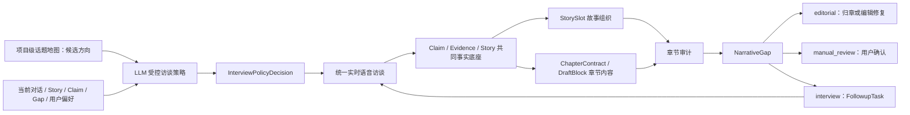

# 回忆录结构化访谈与成书补全重构规划

## 文档状态

本文档是 Pawtale 回忆录下一阶段“结构化访谈 + 成书补全重构”的规划基线，用于统一后续产品设计、数据模型、开发拆分和验收口径。

- 状态：第一轮阶段 0/A/B/C/D/E 已实现；本文继续作为当前实现边界和后续演进基线。
- 当前修订：已吸收固定覆盖框架降级、Utterance 异步归属快照、刷新原子发布、Claim 双重用途和 LLM 受控策略层的 review 结论。
- 适用范围：回忆录项目级采集框架、引导访谈、章节审计、成书补访及其小程序体验。
- 上游事实架构：`docs/MEMOIR_NARRATIVE_ARCHITECTURE.md`。
- 上游语音架构：`docs/MEMOIR_VOICE_CHAT_REDESIGN.md`。
- 不取代：Claim、Evidence、Story、ChapterContract、DraftBlock 等叙事事实模型，也不重写 VAD、Streaming ASR、LLM/TTS 和录音状态机。
- 变更规则：如果实现证明本文的边界或约束不成立，必须先修改本文并说明证据、迁移影响和替代方案，不能通过临时 JSON、兼容分支或 Prompt 补丁绕开。

本文先固定稳定的业务边界和目标模型。精确 PR 数量可以根据实际依赖调整，但不得改变本文规定的数据真相和职责分层。

### 当前实现状态（2026-07-16）

| 范围 | 状态 | 当前结果 |
| --- | --- | --- |
| 阶段 0 / A / B | 已完成 | 成书补全状态所有权、Gap action、统一 Claim policy、ChapterCompletionSummary 和单一 refresh Job 已切流，旧 CompletionItem/生成 Job 已删除 |
| C1 / C2 | 已完成 | 受控策略动作、InterviewBrief、不可变决策日志、assignment/answer 分离和 shadow evaluation 已落地 |
| C3 | 已完成 | `continue_listening`、`follow_current_story`、`summarize_and_confirm` 可按 rollout 配置低风险执行，其他动作仍受候选集和风险门禁约束 |
| D0 / D1 / D2 | 已完成 | 话题地图被动匹配、用户 resolution、只读小程序入口、软锚点和 `offer_new_topic` 候选已落地 |
| E | 已完成 | Gap primary/involved 单一真相、审阅事件/Job 直接关联与索引、无客户端使用的 resume/cancel API 已清理 |
| 成书补全旧实现清理 | 已完成 | 未使用的列表 API、精细章节结构编辑、一次性叙事回填/切换/质量评估工具已删除；章节方向收敛为系统建议、素材同步、workspace 读取和用户确认 |
| 偏好学习 / 强化学习 | 未开始 | 继续等待足量真实 outcome、human rating、脱敏和权限审查数据，不属于第一轮完成范围 |

## 一、执行摘要

下一阶段不是把“成书补全”继续扩展成更大的万能完整度系统，而是建立两条职责不同、共享事实底座的业务链：

1. **结构化访谈**负责项目级采集导航，回答“人生中的哪些方面已经讲过、哪些还可以讲”。
2. **成书补全**负责章节级审校与修复，回答“当前这章为什么不好理解、缺的是新素材、编辑调整还是事实确认”。

结构化访谈的核心机制从“固定框架决定下一题”调整为“LLM 根据当前这个人的讲述状态选择受控对话策略；话题地图只提供候选方向，事实系统和用户决定负责兜底”。模型拥有对话策略选择权，不拥有业务真相写入权。

两条链共享：

- 原始音频、Utterance 和 TranscriptVersion；
- Claim、ClaimEvidence 和 Story；
- 实时语音访谈能力；
- 已知事实、避免重复追问和隐私过滤能力。

共享的是事实与基础能力，不是“这部分是否已经完成”的判断。第一版框架只被动观察和组织已有素材；只有用户主动选择“给我一个方向”时，框架才作为会话的软锚点参与提问。

两条链不能共享：

- 同一套覆盖状态；
- 同一套持久任务表；
- 同一种完成条件；
- “空白就必须补”的产品逻辑。

成书补全现有核心链路应保留：

```text
NarrativeGap
 -> FollowupTask
 -> VoiceSession / MemoirUtteranceInterviewAssignment
 -> 回答用途判断
 -> Claim / Story / ChapterSourceLink / NarrativeDecision
 -> Task 与 Gap 重新评估
 -> 受影响 DraftBlock stale
 -> 章节重新审计
```

需要重构的是外围编排：

- 不再把所有章节问题都转换成访谈任务；
- 不再维护审计 Job 和确定性任务生成 Job 两套异步状态；
- 不再通过 CompletionItem、全书概览、章节工作台和小程序分别解释同一批 Gap/Task；
- 不再让“跳过一个问题”隐式排除整个 Story 和一批上下文 Claim；
- 不让未来结构化访谈框架与 StorySlot、NarrativeGap、FollowupTask 形成第四套互相同步的完整度真相。

## 二、现状与问题

### 2.1 当前已经正确建立的能力

当前实现已经具备以下长期价值，不应在重构中回退：

- Gap 是有稳定 ID、fingerprint、检测次数和处理状态的持久问题，不是一次 LLM 建议文本。
- FollowupTask 是针对 Gap 的可执行访谈动作，不等于 Gap 本身。
- FollowupTaskClaim 保存 known、do_not_repeat 和 expected_evidence 等任务语境。
- MemoirUtteranceInterviewAssignment 在异步处理前保存创建时目标，FollowupTaskAnswer 单独记录事后回答关系，避免用户换题后回答归错任务。
- 补全回答会区分直接讲述、编辑解释、事实修正和混合回答。
- 只有直接讲述进入普通叙事提取；编辑解释和事实修正走各自的应用逻辑。
- 新事实可以解决其他相关 Task/Gap，不要求用户严格只回答当前问题。
- 新回答会使受影响的 DraftBlock stale，并触发重新审计，而不是静默覆盖已确认正文。
- 小程序已经能够向用户说明回答是已入章、作为章节说明保存、仍在处理或需要确认。

这些能力承担数据回溯、事实安全和异步一致性责任，不能为了减少表数量而压平。

### 2.2 当前 guided interview 仍是 Prompt 级引导

当前 `guided_interview` 主要依赖：

```text
guidance_mode = guided_interview
current_guidance_module = person / event / place / period / theme
Prompt 中的主题菜单和追问规则
```

它能够改变 AI 的提问方式，但不能稳定回答：

- 某个项目已经覆盖了哪些人生主题；
- 某个主题由哪些 Claim 支撑；
- 用户是否明确选择不适用或接受不完整；
- 多次自由讲述是否已经补足某个主题；
- 模板升级后旧项目使用的是哪个版本。

因此结构化访谈必须引入持久项目框架，不能继续把覆盖状态放进 Prompt、会话 metadata 或前端本地状态。

### 2.3 章节问题与访谈需求混在一起

当前语义审计已经能检查：

- 本章背景和重点；
- 开头、结尾和转场；
- 人物首次出现和人物关系；
- 履历式罗列；
- 因果、指代、重复、矛盾和无来源事实。

但语义输出只表达“发现了什么 Gap”，没有表达“应该如何解决”。Planner 对大多数有关联 Story/Claim 的 Gap 都会生成 FollowupTask。

这会把以下不同问题混成同一种用户动作：

```text
缺少讲述者掌握的信息       -> 应采访
已有素材但没有写进本章     -> 应归章或调整结构
已有素材但正文表达生硬     -> 应编辑 DraftBlock
事实互相矛盾               -> 应确认或修正 Claim
用户只是不想再回答这个问题 -> 应关闭问题，不应自动排除事实
```

### 2.4 同一章节状态被多次投影

当前至少存在以下状态解释层：

1. Gap 状态；
2. FollowupTask 状态；
3. CompletionItem kind/status/action；
4. BookCompletion chapter state/action；
5. ChapterWorkspace 原始分组；
6. 小程序计算的 nextAction、readiness、方向数量和是否可生成正文。

它们不是六类独立业务事实，而是同一批 Gap、Task、Job、DraftBlock 的重复读模型。重复投影导致：

- 状态映射容易漂移；
- 小程序需要并行请求多个 API 才能判断下一步；
- 全书概览和章节工作台可能给出不同结论；
- 删除旧状态和旧 API 变得困难；
- 后续接入项目框架时容易再增加一套“统一状态”。

### 2.5 两个异步 Job 放大了状态空间

章节 Gap 审计包含 LLM 语义检查，适合异步执行；但 FollowupTask 生成是确定性数据库规划，不调用外部模型。当前把二者拆成两个 EditingJob，使用户界面必须同时判断：

- audit pending/running/succeeded/failed；
- generation pending/running/succeeded/failed；
- audit 已变化但 generation 尚未追上的中间状态。

这类中间状态没有独立产品价值，应合并为一次“刷新章节补全状态”操作，在事务外完成分析和规划，最后用一个短事务原子发布 Gap/Task。

## 三、目标产品边界

### 3.1 四层业务语义

系统只保留以下四层互不替代的语义：

| 层级 | 核心对象 | 回答的问题 | 是否阻塞成书 |
| --- | --- | --- | --- |
| 项目采集层 | ProjectFramework / FrameworkItem（产品语义为话题地图） | 人生哪些方面出现过素材、可作为哪些候选方向 | 否 |
| 故事组织层 | Story / StorySlot | 一个故事有哪些组成部分还可补充 | 否 |
| 章节审校层 | NarrativeGap | 当前章节或全书有什么逻辑、事实、来源或结构问题 | 仅 high correctness gap 可能阻塞 |
| 执行动作层 | FollowupTask | 某个 Gap 是否需要一次具体补访 | Task 本身不直接作为成书门槛 |

稳定约束：

- FrameworkItem 为空不自动创建 NarrativeGap。
- StorySlot 缺失不自动阻止已有事实成稿。
- NarrativeGap 不自动等于 FollowupTask。
- FollowupTask 完成不自动等于回答已经进入正文。
- FrameworkItem 已有素材或用户选择“目前讲这些就够了”，都不自动等于任何章节已经写好。
- 章节缺少框架中已有的信息时，先检查归章、Story/Claim 关联和 DraftBlock，而不是再次询问用户。



### 3.2 用户入口

项目创建时继续保留两个主要选择：

```text
自主讲述
 -> guidance_mode = free_narration
 -> 用户按自己的节奏讲
 -> 后台被动更新话题地图，策略优先继续倾听和顺着当前故事

按照主题来问
 -> guidance_mode = guided_interview
 -> 展示项目级话题地图
 -> LLM 从受控策略动作和候选 Topic 中选择自然追问或建议新方向
 -> 用户选择 Topic 后仅作为会话开场软锚点
```

成书后的补充入口继续独立存在：

```text
补全这本书
 -> session_goal = book_completion
 -> 只消费真正需要讲述者输入的 FollowupTask
```

`guidance_mode` 表达交互强度，`session_goal` 表达业务目标。两者不能复用同一字段。

### 3.3 LLM 是访谈策略选择者，不是业务真相写入者

每轮对话由策略层读取统一上下文，并在系统给定的候选动作中选择下一步：

```text
当前对话 + Story + Claim + Gap + 用户偏好 + 话题地图
                        ↓
             LLM 选择受控策略动作
                        ↓
             LLM 生成自然回应或问题
                        ↓
          领域服务保存回答并更新事实对象
```

第一版动作枚举保持小而稳定：

```text
continue_listening          # 继续倾听，不抢话
follow_current_story        # 顺着当前故事追问
ask_person_relationship     # 询问人物关系
ask_cause_or_result         # 询问原因、影响或结果
summarize_and_confirm       # 总结后请用户确认理解
return_to_prior_story       # 建议回到之前未讲完的故事
offer_new_topic             # 提供一个新的候选话题
pause_or_end                # 暂停或结束本轮
```

边界：

- 系统根据 session goal、当前状态、安全策略和用户设置生成 `candidate_actions`；模型只能从候选集合选择，结构化响应不合法时不得执行越界动作。
- `free_narration` 默认提高继续倾听和顺势追问的优先级；`guided_interview` 可以更主动提供人物、事件、地点和人生阶段等候选方向，但不能要求用户按地图逐项完成。
- 第一轮 active rollout 只自动执行继续倾听、沿当前故事追问和总结确认等低风险动作；回到旧故事、提供新话题先保持建议式或用户主动触发，必须经过 Shadow Mode 评估后再扩大权限。
- 模型可以建议最自然的对话动作，但不能决定 Claim 真伪、publication、隐私范围、用户 resolution、Gap 是否已经解决或 `recommended_action` 的最终写入。
- 高风险业务动作由确定性 service 执行并校验权限；策略输出不能直接调用删除、排除、事实确认或成书状态迁移接口。

## 四、目标数据模型

### 4.1 继续作为共同事实底座的对象

```text
AudioFile
MemoirVoiceSession
MemoirVoiceUtterance
MemoirTranscriptVersion
MemoirClaim
MemoirClaimEvidence
MemoirStory
MemoirStoryClaim
MemoirStorySlot
MemoirChapterContract
MemoirDraftBlock
```

结构化访谈和成书补全只能通过这些对象共享事实，不能互相读取对方的内部状态来推断内容真相。

### 4.2 项目级结构化访谈模型

第一版模板使用仓库内不可变、版本化的 JSON 定义，由 Pydantic 在加载时校验，不建设可在线编辑的模板后台。项目初始化时同时保存模板快照，不能依赖未来代码仍保留某个 Python 定义才能还原历史框架。

```text
FrameworkTemplateDefinition        # 仓库内不可变 JSON + Pydantic 校验，不是数据库表
  template_key
  version
  modules[]
  items[]
    item_key
    module_key
    title
    intent
    evidence_hints
    sort_order

MemoirProjectFramework
  id
  project_id                       # 第一版每项目一个当前框架
  template_key
  template_version
  template_snapshot_json           # 初始化时保存的规范化不可变快照
  template_hash                    # 快照内容 hash
  created_at
  updated_at

MemoirFrameworkItem
  id
  project_framework_id
  item_key                         # 来自指定模板版本
  module_key                       # person/event/place/period/theme 或后续版本定义
  sort_order
  evidence_state                   # none / has_material；系统根据有效关联重算
  user_resolution                 # none / enough_for_now / not_applicable / do_not_discuss；只由用户动作修改
  assessment_summary
  assessment_version
  user_resolution_note
  resolved_by_user_id
  resolved_at
  deferred_until                   # 只影响建议时机，不改变 evidence_state/user_resolution
  defer_reason
  updated_at

MemoirFrameworkItemClaim
  framework_item_id
  claim_id
  evidence_role                    # supports / contradicts
  match_source                     # manual / evaluator / backfill
  matcher_version                  # manual 关联可为空
  confidence                       # 自动匹配置信度，不能直接充当覆盖率
  created_at
  updated_at
```

模型约束：

- `item_key` 必须来自 `template_key + template_version` 的版本化定义。
- `template_snapshot_json` 是项目使用版本的还原依据，`template_hash` 必须与规范化快照一致；仓库中的历史模板文件也不得删除或原地修改。
- 模板升级必须显式迁移，不能在读取时静默套用新模板。
- `evidence_state` 与 `user_resolution` 是两个独立维度，不能拼回一个持久化综合枚举。
- 第一版不持久化 `likely_sufficient` 或覆盖百分比；如果未来真实评估证明需要，必须另行修改本文并提供误判数据和用户价值。
- Coverage evaluator 可以随着 Claim 增删、拒绝或替代让 `evidence_state` 在 `none` 与 `has_material` 之间双向变化，但不能修改 `user_resolution`。
- 用户可以设置或撤销 `enough_for_now/not_applicable/do_not_discuss`；AI 和 backfill 不得覆盖人工决定。`do_not_discuss` 必须进入策略层 safety constraints，使该 topic 不再成为追问候选。
- “以后再补”通过 `deferred_until/defer_reason` 表达，不能伪装成证据或用户 resolution；到期后只恢复候选资格。
- `UNIQUE(project_framework_id, item_key)` 和 `UNIQUE(framework_item_id, claim_id)` 必须由数据库保证。
- 子表不重复存 `project_id`，鉴权和项目隔离通过显式外键 join 完成；如未来因真实性能证据需要反范式存储，必须增加复合外键或等价一致性约束。
- 自动 evaluator/backfill 关联按 `match_source + matcher_version` 幂等 reconcile；manual 关联只能由用户动作修改。Claim 被 rejected 时关联不作为有效证据，superseded 时通过 Claim policy 使用有效后继版本；不得因匹配器升级删除 manual 关联。
- FrameworkItem 不直接关联 Chapter、NarrativeGap 或 FollowupTask。
- 第一版不创建 Question 表；问题由模板意图、当前 Claim 和最近对话动态生成。
- 第一版不创建 FrameworkItemStory 表；需要 Story 时通过 FrameworkItemClaim -> StoryClaim 推导，避免重复关系。

小程序展示状态由两个字段计算，不再落库第三份状态：

```text
user_resolution=not_applicable -> 不适合我的经历
user_resolution=do_not_discuss -> 不想聊这个
user_resolution=enough_for_now -> 目前讲这些就够了
evidence_state=has_material    -> 已经聊过
其他                           -> 还可以聊
```

### 4.3 NarrativeGap 增加解决通道

在 Gap 层增加受控字段：

```text
recommended_action
  interview
  editorial
  manual_review

action_reason_code
  MISSING_NEW_EVIDENCE
  EXISTING_MATERIAL_AVAILABLE
  FACT_CONFLICT_DETECTED
  PUBLICATION_DECISION_REQUIRED
  DRAFT_USAGE_PROBLEM

action_decision_source             # deterministic_policy / migration / manual_override
action_policy_version
```

含义：

- `interview`：缺少讲述者掌握的信息，可以生成 FollowupTask。
- `editorial`：已有事实基本足够，应调整归章、结构节点或 DraftBlock。
- `manual_review`：需要用户确认事实、人物、时间、来源或收录决定，不适合自动改写。

约束：

- `recommended_action` 是问题的解决通道，不替代 Gap status。
- LLM 审计只输出可校验的 finding、证据引用和基础 reason signal，不能直接决定 `recommended_action`。
- Completion planner 根据 Claim 可用性、DraftBlock 使用关系、冲突和收录决策等确定性规则，将 `action_reason_code` 映射成 action；映射必须版本化并可单元测试。
- 例如已有可发表 Claim 但 DraftBlock 未使用时，必须得到 `DRAFT_USAGE_PROBLEM -> editorial`，不能因模型措辞变化而生成补访任务。
- `action_decision_source` 记录动作由确定性策略、迁移还是明确人工覆盖产生，人工覆盖必须通过独立 service 并可撤销。
- 它不进入 Gap fingerprint；同一个稳定问题改变解决方式时仍是同一个 Gap。
- 只有 `interview` 可以自动创建或保持 active FollowupTask。
- 已经 in_progress 的 Task 不因审计重算而在用户回答过程中被切换通道。
- `editorial` 修复完成后仍需重新审计才能解决 Gap。
- `manual_review` 不得通过继续采访自动绕过用户确认。

### 4.4 FollowupTask 保持独立

FollowupTask 继续表达一次可执行补访，并保留：

```text
gap_id
chapter_id
story_id
target_slot
answer_use
question
purpose
known_context_summary
priority
status
assigned_session_id
```

不把 FrameworkItem 合并进 FollowupTask，原因是：

- FrameworkItem 是长期话题地图节点，可以被多次会话持续关联素材；
- FollowupTask 是某个 Gap 的一次处理动作，Gap 变化后可能取消或解决；
- FrameworkItem 的 evidence/user resolution 不等于章节问题解决；
- FollowupTask 的 answered 不等于某个人生主题充分覆盖。

### 4.5 VoiceSession 使用软锚点，Utterance 固定异步归属

新增：

```text
anchor_framework_item_id   # optional；当前会话的开场/重新进入话题锚点
```

保留：

```text
current_followup_task_id   # optional
```

数据库和 schema 约束：

- 两者最多一个非空。
- `current_followup_task_id` 只允许 `session_goal=book_completion`。
- `anchor_framework_item_id` 只允许 `session_goal=open_narration` 且 `guidance_mode=guided_interview`。
- FrameworkItem 只决定开场问题或用户明确请求“换一个方向”时的方向；用户自由展开后，不因偏离 anchor 拉回，不在会话中自动切换主题。
- 只有用户主动选择“给我一个方向”、主动换方向，或新建 guided session 时，系统才设置或更换 anchor。
- 一段会话产生的 Claim 可以匹配多个 FrameworkItem；anchor 不是该会话素材的唯一归属。
- `current_guidance_module` 在迁移期可以保留为 UI/Prompt 辅助字段，但不再作为覆盖状态真相。
- FrameworkItem 完成切流后，如果 `current_guidance_module` 不再有独立交互价值，应删除而不是永久双写。
- 不引入无外键约束的 `target_type + target_id` 万能多态字段。

Session 上的字段会随用户换题而变化，因此不能用于异步完成后的 Utterance 归属。将现有 TaskUtterance assignment snapshot 收敛成一个带显式外键的目标模型：

```text
MemoirUtteranceInterviewAssignment
  utterance_id                     # UNIQUE，写入后不可改变目标
  framework_item_id                # nullable
  followup_task_id                 # nullable
  policy_decision_id               # nullable；关联产生本轮系统回应的策略决策
  created_at
```

约束：

- `framework_item_id` 与 `followup_task_id` 最多一个非空，不使用 `target_type + target_id`。
- Utterance 创建时，在同一事务内读取 Session 当前选择并写入 assignment；后续转写、Claim 提取和回答应用只读 assignment，不能回读 Session 当前字段推断归属。
- 无结构化访谈目标的自由讲述允许两个目标外键都为空；如果本轮由策略层产生系统回应，仍通过 `policy_decision_id` 关联当时上下文和 brief fingerprint。
- `policy_decision_id` 非空时，assignment 的 target 必须与该决策记录一致，由创建 service 校验；不能关联到另一问题的策略记录。
- assignment 的目标外键不可更新；纠错通过显式更正事件或重建下游关联完成，不能静默改写历史。
- 阶段性交付中，C1 先落 `utterance_id + followup_task_id + policy_decision_id`；D0 创建 FrameworkItem 实体时再以同一次受约束迁移加入 `framework_item_id` 外键，不提前保留无外键占位列。

### 4.6 共享 InterviewBrief，而不是共享任务表

语音编排层使用统一的只读 DTO：

```text
InterviewBrief
  source_kind              # open_narration / framework / book_completion
  target_id
  purpose
  opening_question
  candidate_actions
  current_story_state
  conversation_momentum
  user_preferences
  safety_constraints
  existing_material
  unresolved_gaps
  known_claims
  do_not_repeat_claims
  expected_evidence_hint
  completion_policy
  template_version
  policy_version
```

`InterviewBrief` 本身仍是运行时 DTO，只负责把不同业务目标转换成语音系统能消费的上下文；不持久化完整 Prompt 或复制一份可变业务对象。但每次策略决策必须保存足以解释当时提问依据的轻量快照，并由后续 Utterance assignment 关联该决策：

```text
InterviewBriefContextSnapshot
  schema_version
  source_kind
  framework_item_id                # nullable，和 followup_task_id 最多一个非空
  followup_task_id                 # nullable
  template_version                 # book completion 可为空
  policy_version
  completion_policy
  current_story_state              # 受控枚举/结构，不复制 Story 正文
  conversation_momentum
  user_preference_snapshot
  safety_constraint_codes[]
  existing_material_refs[]
  unresolved_gap_ids[]
  known_claim_ids[]
  do_not_repeat_claim_ids[]
  brief_fingerprint
```

该结构写入 `InterviewPolicyDecision.state_snapshot_json`，只承载不可变审计快照，不作为查询当前 Framework/Task 状态的来源。fingerprint 由规范化 brief 计算，必须能回答“当时基于哪个模板、策略和 Claim 集合提出这个方向”，但不保存 provider key、完整 Prompt 或敏感 Claim 正文。assignment 不再复制第二份 snapshot。

- FrameworkItem adapter 从模板快照、item claims、evidence state 和用户 resolution 生成 brief。
- FollowupTask adapter 从 task claims、answer use 和 pending confirmation 生成 brief。
- Conversation context adapter 提供当前 Story 状态、对话势能、用户偏好和未解决 Gap 的受控摘要。
- Voice assistant 和策略层只消费 brief，不直接查询 FrameworkItem、FollowupTask 或 Claim 表的内部结构。

### 4.7 InterviewPolicyDecision 保存策略学习样本

策略选择必须可解释、可回放，并为后续 Prompt 优化、偏好学习或强化学习保留真实反馈：

```text
InterviewPolicyDecision
  id
  session_id
  trigger_message_id
  brief_fingerprint
  state_snapshot_json              # 规范化特征和对象 ID，不复制敏感正文
  candidate_actions_json
  selected_action
  reason_code
  reason_summary
  policy_version
  model_provider
  model_name
  execution_mode                   # shadow / suggest / active
  generated_message_id             # 引用已持久化消息，不重复保存问题正文
  user_response_outcome
  human_rating
  created_at
  evaluated_at
```

约束：

- `selected_action` 必须属于同一条记录的 `candidate_actions`；Shadow Mode 也记录模型选择，但不改变实际对话。
- 用户回答通过 MemoirUtteranceInterviewAssignment.policy_decision_id 反查，不在决策表再保存 `utterance_id`，避免双向关系漂移。
- `state_snapshot_json` 只用于审计和离线评估，不成为当前业务状态来源；schema 必须版本化，Utterance assignment 只引用它而不复制。
- `generated_message_id` 关联实际发送的自然回应；不在决策表重复保存完整 Prompt、转写或 Claim 正文。
- `reason_summary` 只允许保存短、脱敏的策略解释，不得复制用户原话或敏感 Claim；可解释性优先依赖 reason code、对象 ID 和版本化 snapshot。
- `user_response_outcome` 使用受控结果，例如 continued_story、answered_question、changed_topic、confused、stopped；不能由“回答更长”直接推断策略更好。
- `human_rating` 第一版可空，只有明确的用户/评审动作才能写入，不能把模型自评当成人工评分。
- 策略版本、候选动作、选择和结果属于产品评估数据；访问控制、脱敏、保留期必须与语音/转写数据同级处理。

## 五、成书补全目标重构

### 5.1 统一刷新操作

将以下两步合并：

```text
RECOMPUTE_CHAPTER_STRUCTURE_AUDIT
GENERATE_FOLLOWUP_TASKS
```

目标流程：

```text
RefreshChapterCompletion Job
 -> 读取带 source revision 的 ChapterAuditContext
 -> 在写事务外运行确定性规则审计和 LLM 语义审计
 -> 在内存形成 findings 与 evidence references
 -> Completion planner 确定性计算 action reason/action 和 FollowupTask plan
 -> 校验完整发布集
 -> 在一个短事务中校验 source revision，并原子 reconcile Gap + Task
 -> 由唯一 query service 按当前事实构造 ChapterCompletionSummary
```

实现约束：

- 外部 LLM 调用前不得长期持有 SQLite writer lock。
- LLM、Planner 或发布前校验任一步失败，整次刷新不发布，数据库继续保留上一版一致的 Gap/Task；不能先提交 Gap 再通过 savepoint 局部保留结果。
- 发布事务必须再次校验 Chapter/DraftBlock/Claim source revision。运行期间源数据已变化时丢弃本次结果并重新排队，不能用过期审计覆盖新事实。
- 一个 Job 只暴露一套 pending/running/succeeded/failed 状态。
- Job result 可以记录失败阶段和耗时用于诊断，但不能把 audit 成功/planner 失败暴露成产品上的部分成功。
- 失败后 ChapterCompletionSummary 将上一版结果标记为 stale，并显示刷新失败/可重试；不得展示尚未原子发布的新 Gap。
- 删除独立 `GENERATE_FOLLOWUP_TASKS` handler、failure event 和 generation API。

### 5.2 统一 ChapterCompletionSummary

后端提供唯一章节补全读模型：

```text
ChapterCompletionSummary
  chapter_id
  state
  refresh_status
  refresh_is_current
  next_action
  must_handle_count
  suggested_count
  accepted_incomplete_count        # 仅统计 Gap 级用户 resolution
  active_task
  visible_tasks[]           # 最多三项
  editorial_gaps[]
  review_gaps[]
  draft_readiness
  headline
  detail
```

`ChapterCompletionSummary` 第一版只作为查询响应/应用层 DTO，不新增持久 snapshot 表。只有出现经过测量的真实性能瓶颈，并且具备明确失效机制时，才重新评估是否需要缓存。

建议的 next action：

```text
create_direction
confirm_direction
refresh_completion
wait
continue_confirmation
start_interview
open_editorial_fix
open_manual_review
generate_draft
review_draft
complete
```

消费方式：

- 全书补全概览读取 summary 的精简字段。
- 章节工作台读取同一个 summary 加详细列表。
- 小程序不再根据多个 API 的原始状态重新实现业务优先级。
- DraftBlock 详情仍可独立分页或按需读取，不要求把全文塞进 summary。

完成切流后删除：

- CompletionItem schema/service/enums；
- BookCompletionAction；
- prepare API 中小程序不使用的完整 response；
- 小程序 `chapterNextAction` 中与后端重复的业务判断。

### 5.3 明确用户动作语义

补访任务提供以下动作：

```text
换一个
想不起来 -> unable_to_answer
问问家人再说 -> ask_family_later
以后再说 -> deferred
不再问这个问题 -> closed_without_answer，不修改 Story/Claim publication
```

这些 outcome 只描述一个具体 Task 的结果，不能直接写入 FrameworkItem 或把整个 Gap 标为“接受不完整”。如果用户要接受一个长期 Gap 或一个框架主题当前不完整，必须通过对应对象的独立用户决策动作完成。

内容收录决定移出 Task 控件：

```text
整个故事不收录 -> Story publication decision + 独立确认
某条事实不收录 -> Claim publication decision + 独立确认
章节不收入本书 -> Chapter include_in_book decision
```

不得从 FollowupTaskClaim 的 known/do_not_repeat 关系推导要排除的 Claim 范围。

### 5.4 Gap 关系的当前结构

Gap 关系已经完成单一真相迁移：

- `primary_*` 是 scope 的唯一权威字段；
- GapStory/GapChapter 只保存额外 involved 对象；
- API 需要完整关系列表时动态组合；
- 历史 role=primary 行已在迁移前校验与 `primary_*` 一致，再从关系表删除；
- 新写入不再保存 relation role，也不允许把 primary 对象重复写成 involved。

## 六、端到端业务流程

### 6.1 按照主题来问

```text
创建 guided_interview 项目
 -> 初始化 ProjectFramework 和 FrameworkItem
 -> 用户看到“已经聊过 / 还可以聊”的话题地图
 -> 创建 open_narration VoiceSession
 -> adapters 根据当前对话、事实和话题候选生成 InterviewBrief + candidate_actions
 -> LLM policy 选择继续听、顺势追问、总结确认或提供新方向
 -> 用户接受一个新方向时设置 anchor_framework_item_id
 -> LLM 生成自然回应，保存 InterviewPolicyDecision
 -> 复用实时 ASR / TTS 访谈
 -> Utterance 创建时固化 assignment，并关联产生本轮回应的 policy decision/context snapshot
 -> Utterance 正常进入 Claim / Story ingestion
 -> Framework evaluator 将新 Claim 匹配到一个或多个 item 并更新 evidence_state
 -> 用户看到“已经讲到什么”和模型建议的下一步
```

话题地图没有“必须全部完成”的完成条件。`has_material` 只表示这里出现过可追溯素材；模型是否继续追问由当前故事势能、用户偏好、已知内容和候选动作共同决定，不能由 item 状态单独决定。

### 6.2 自主讲述

```text
创建 free_narration 项目
 -> 不绑定 FrameworkItem
 -> 用户自由讲述
 -> LLM policy 优先继续倾听、沿当前 Story 追问或总结确认
 -> Utterance 正常进入 Claim / Story ingestion
 -> 后台将新 Claim 被动匹配到 FrameworkItem
 -> 除非用户主动求助或对话明显停止，不提供新话题、不自动切换为强引导
```

自由讲述可以丰富话题地图，但地图不能反过来约束用户的叙述顺序。模型在自由模式下选择动作的目标是保持自然讲述，而不是提高覆盖率。

### 6.3 成书补全

```text
用户进入全书补全概览
 -> 后端读取各章 ChapterCompletionSummary
 -> 用户选择一章
 -> 如果 audit stale，触发 RefreshChapterCompletion Job
 -> Gap 按 recommended_action 分流
    -> editorial：打开章节编辑/局部重写
    -> manual_review：打开确认界面
    -> interview：展示最多三个 FollowupTask
 -> 用户选择一个 Task
 -> 创建 book_completion VoiceSession + current_followup_task_id
 -> FollowupTask adapter 生成 InterviewBrief
 -> candidate_actions 受 Task purpose 和 safety constraints 限制
 -> LLM policy 可以自然追问或总结确认，但不能更改 Task/Gap 业务状态
```

### 6.4 补全回答后的闭环

```text
用户回答
 -> 先保存 Utterance 与 TranscriptVersion
 -> 使用 MemoirUtteranceInterviewAssignment 锁定原 Task 或话题 anchor
 -> 判断 direct_narrative / clarification / fact_resolution / mixed
 -> direct_narrative 进入 Claim / Story ingestion
 -> clarification 进入章节编辑上下文
 -> fact_resolution 更新事实决策或进入用户确认
 -> 只在满足对应完成条件时将 Task 标记 answered
 -> 重新评估 Gap
 -> 标记受影响 DraftBlock stale
 -> 重新运行章节补全刷新
 -> CompletionOutcome 告诉用户实际结果
```

用户可观察结果必须区分：

- 已收入某章素材；
- 已作为章节说明保存；
- 已完成事实修正；
- 需要进一步确认；
- 已保存但仍在处理；
- 未作为书稿素材使用。

## 七、两条业务链的结合规则

### 7.1 允许的共享

- FrameworkItem 和 FollowupTask 都可以引用 Claim 作为已知上下文。
- 两者都复用 InterviewBrief、InterviewPolicyDecision、VoiceSession、ASR、TTS 和对话 UI。
- 新 Utterance 的 Claim 可以同时让 FrameworkItem 进入 `has_material`，并解决一个已有 Gap。
- 策略层可以用 FrameworkItem、Story 和 Gap 构造候选方向，但只能通过 adapter 读取受控摘要。
- 两者都可以使用 do_not_repeat 语义，但来源和完成规则分别维护。

### 7.2 禁止的耦合

- 不因为 FrameworkItem `evidence_state=none` 就创建 Gap 或 FollowupTask。
- 不因为 FrameworkItem 已有素材或被用户标记 `enough_for_now` 就自动解决章节 Gap。
- 不把 FollowupTask answered 直接写成 FrameworkItem `has_material`；必须先产生有效 Claim 并建立匹配关系。
- 不把 Chapter ID 存进 FrameworkItem 作为固定归章目标。
- 不把模板 item 预先展开成固定问题记录。
- 不让结构化访谈成为正式成书门槛。
- 不建设包含 framework/gap/task/story_slot 的万能 requirement 表。
- 不让 LLM 策略动作直接修改 Claim、Gap、Task、publication 或用户 resolution。

### 7.3 现有素材优先策略

当章节审计发现缺少背景、人物说明、转场或结尾时，按以下顺序处理：

1. 检查本项目是否已经存在相关 Claim/Story。
2. 检查素材是否只是未归入本章或未绑定当前节点。
3. 检查 DraftBlock 是否 stale 或没有使用已有 Claim。
4. 如果已有素材足够，创建/保持 editorial Gap，不生成访谈任务。
5. 只有明确缺少讲述者掌握的信息时，才创建 interview Gap 和 FollowupTask。

话题地图可以作为查找已有材料的导航信号，但 Claim/Evidence 才是是否已有事实的最终依据。

### 7.4 Claim 的“对话已知”与“可用于成书”分开

统一 Claim policy service 根据 Claim 当前状态计算两个用途，不在不同 adapter 中分别写过滤条件：

| Claim 状态 | known_for_conversation | usable_for_publication |
| --- | --- | --- |
| 正常有效 | 是 | 是 |
| private | 是，仅用于避免重复和安全约束 | 否 |
| excluded | 是，仅用于避免重复和安全约束 | 否 |
| rejected as false | 否，不作为已知事实；保留“曾被否定”的冲突语境 | 否 |
| superseded | 使用有效后继版本 | 否 |

约束：

- FrameworkItem 的 `evidence_state` 根据 `known_for_conversation` 计算，因此用户已经讲过但不愿入书的内容不会被反复询问。
- 章节归章、DraftBlock 和 editorial 判断只能使用 `usable_for_publication`。
- private/excluded Claim 不能作为可发表材料或 expected evidence 进入生成，但策略层必须收到受控的 do-not-repeat/safety 标记，不能因正文不可用而再次追问。
- Framework assessment summary 和小程序已知内容摘要必须再次经过当前 actor 的可见性过滤；不能因为 private/excluded Claim 参与防重复判断就把其正文重新展示出来。
- rejected Claim 不能阻止系统询问正确版本；superseded Claim 的旧版本不能重复进入 Prompt。
- 第一版由 policy service 动态计算两个用途，不新增可漂移的持久布尔字段。

## 八、小程序目标体验

### 8.1 话题地图与结构化访谈页

用户看到的是可理解的话题地图，而不是完成度仪表盘：

```text
已经讲过
还可以继续讲
目前讲这些就够了
以后再补
不适合我的经历
不想聊这个
```

要求：

- 不展示伪精确覆盖百分比；
- 每次最多突出一个由策略层建议的方向，但允许用户继续当前故事或自行换模块；
- 显示已知内容的简短摘要，避免重复询问；
- 用户可以选择目前讲够了、标记不适用或明确不想讨论，并可撤销决定；
- 模型不能用“还有空白”作为打断当前叙述或强制换话题的理由；
- 话题模块不是章节目录，不能让用户误以为每个模块都会生成一章。

### 8.2 成书补全页

全书概览继续按章节展示，但明确区分：

- 需要补讲；
- 需要确认；
- 可以由系统重新整理；
- 当前不需要处理。

章节工作台只突出一个 next action，同时允许用户查看最多三个补讲方向。编辑问题不得伪装成需要老人继续录音的问题。

### 8.3 动作安全

- “不再问”不能改变书稿收录范围。
- “不收录故事/事实/章节”必须显示准确影响范围并单独确认。
- “想不起来”不得显示成“已确认事实”。
- “回答已保存”不能等同于“已入章”。
- 任何失败提示都必须说明录音、转写和已有正文是否受到影响。

## 九、迁移与兼容策略

### 9.1 新话题地图采用增量迁移

- 新增 ProjectFramework、FrameworkItem、FrameworkItemClaim 表。
- 表名保留 Framework，但产品和策略语义统一为“话题地图”，不实现固定覆盖进度或完成率。
- 所有新回忆录项目初始化同一版本化话题地图并保存 template snapshot/hash；`guidance_mode` 只影响策略候选和主动程度。
- free_narration 项目保留话题地图用于后台素材匹配，但不绑定 anchor、不主动切换主题。
- 现有 guided_interview 项目在用户首次进入框架页时显式初始化。
- 现有 free_narration 项目在首次需要展示框架或运行覆盖回填时显式初始化。
- 初始化后按统一 Claim policy 用现有 `known_for_conversation` Claim 做一次 evidence backfill，并记录 `match_source=backfill` 和 matcher version。
- 第一阶段 backfill 和新会话匹配只在 Shadow Mode 运行，不改变提问、不向用户展示；误匹配评估达到门禁后才开放只读话题地图。
- 不修改原始音频、Utterance、TranscriptVersion、Claim 或 Story ID。
- 模板升级只通过显式 migration，不在读路径自动生成缺失 item。

### 9.2 现有 Gap/Task 保守迁移

为现有 Gap 回填 recommended_action 时采用保守规则：

- 已存在 active FollowupTask 的 Gap 先写 `recommended_action=interview`、`action_decision_source=migration`，避免中断正在回答的任务；
- repetition 默认 `EXISTING_MATERIAL_AVAILABLE -> editorial`；
- 没有 active Task 且无法确定是否需要新证据的 Gap 默认 `manual_review`，并使用明确 migration reason code；
- 迁移后重新审计可以改变 recommended_action，但不能覆盖人工 resolution。

### 9.3 Utterance assignment 与策略日志迁移

- 新增 MemoirUtteranceInterviewAssignment 和 InterviewPolicyDecision 表后，新 Utterance 只写新 assignment。
- 现有 FollowupTaskUtterance 行无损迁移为 FollowupTaskAnswer；其中明确带 assignment snapshot 的行再回填显式 `followup_task_id` assignment，历史上下文无法还原时 `policy_decision_id` 保持空，不得伪造 InterviewPolicyDecision 或快照。
- 校验任务归属数量和外键后，删除旧 FollowupTaskUtterance 写路径和表，不永久双写。
- 历史会话不回填虚构的 InterviewPolicyDecision；决策日志只从新策略 Shadow Mode 开始记录。

### 9.4 API 删除顺序

以下 API 只有在小程序和其他已知客户端完成切流后才能删除：

- 独立 followup task generation job API；
- 小程序未使用的 prepare response action；
- 独立 resume/cancel endpoint 候选。

删除前必须：

1. 全仓搜索生产调用；
2. 检查 OpenAPI/外部调用记录；
3. 用新流程覆盖现有测试；
4. 删除对应 schema、service、handler、event 和文档，不保留永久兼容壳。

## 十、测试与可观测性

### 10.1 必须覆盖的业务回归

- FrameworkItem 的 `evidence_state` 只能由 Claim policy + 关联关系重算，`user_resolution` 只能由用户动作 service 修改。
- 自由讲述可以更新框架，但不会打断用户或自动开始强引导。
- 一个 FrameworkItem 可由多次会话关联素材；用户设置 `enough_for_now/do_not_discuss` 后，自由讲述产生的新 Claim 仍可更新 evidence，但不会覆盖用户决定。
- 用户可以撤销 `enough_for_now/not_applicable/do_not_discuss`，AI 和 backfill 不能代替用户设置或撤销。
- Claim rejected/superseded 后 evidence 可正确降级或切换到有效版本，manual item-claim 关联不会被 matcher 升级删除。
- template snapshot/hash 能独立还原项目初始化时的话题地图，历史模板文件不会被原地修改。
- 框架空白不会创建 Gap/Task，也不会阻塞成书。
- 已有素材足够的开头/转场问题走 editorial，不生成重复访谈。
- LLM finding 相同且素材关系相同，确定性 action planner 必须产生相同 reason/action；LLM 不能直接写 recommended_action。
- 只有 recommended_action=interview 的 Gap 生成 active Task。
- Refresh Job 在 audit、planner、validation 或 source revision 校验失败时不会发布部分 Gap/Task。
- “不再问”不会修改 Story/Claim publication。
- 明确排除 Story/Claim 时只影响用户确认的目标。
- MemoirUtteranceInterviewAssignment 在 Task 换题、anchor 换方向、异步 ingestion 和跑题情况下仍能正确归属，Session 当前字段不能改变历史 assignment。
- Brief context snapshot 可以还原当时的 template/policy/known/do-not-repeat Claim ID，且不复制完整 Prompt 或敏感正文。
- Claim policy 对 private/excluded/rejected/superseded 的“对话已知”和“可用于成书”判断符合 7.4 表格。
- Shadow Mode 记录模型决策但不改变实际回复；active mode 的 selected_action 必须属于 candidate_actions。
- 自由模式下模型不会因话题地图空白自动选择 `offer_new_topic`，用户偏离 anchor 后不会被强行拉回。
- 直接讲述、编辑解释、事实修正和 mixed 回答保持不同落库行为。
- 补全回答后只标记实际依赖它的 DraftBlock stale。
- 全书概览和章节工作台对同一章节返回一致的状态和 next action。
- 修改章节内容后旧 audit 不会被错误当作 current。
- 模板版本升级和 Gap 关系迁移通过 SQLite schema/外键完整性检查。

### 10.2 评估样本

至少保留以下脱敏真实风险样本：

- 同一事件在多个章节重复出现；
- 用户只想一笔带过的次要事件；
- 开头突兀但项目中已有足够背景素材；
- 人物关系已在其他会话讲清但本章遗漏；
- 用户回答补全问题时跑题并讲出另一个重要故事；
- 澄清回答不应该直接进入正文；
- 事实修正需要确认后才能修改 Claim；
- 同一框架主题经过多次自由讲述逐步补齐；
- 用户明确不适用某个框架主题；
- 用户只跳过一个问题，不排除已有故事；
- 用户正在兴头上连续讲述时，策略应继续倾听而不是切换到空白话题；
- 用户停顿并明确请求方向时，策略可以提供一个新话题，但接受后也不把后续 Claim 限制在该 anchor；
- private/excluded 内容已经讲过但不能入书时，策略不重复追问，成书层也不使用该内容；
- 同一 brief 在 Shadow Mode 下比较模型策略与人工标注动作。

### 10.3 可观测指标

建议记录以下不含原始敏感文本的指标：

- framework item evidence 迁移、用户 resolution 和匹配来源分别计数，不能合并成覆盖率；
- Shadow Mode 的策略选择分布、与人工标注一致率和越界/无效结构化输出率；
- active 策略按 action 统计用户继续讲述、困惑、换题和结束的结果；
- guided session 设置 anchor 后产生相关/跨 item Claim 的分布；
- item-claim 自动匹配错误率、每条 Claim 匹配 item 数量和 matcher version 漂移；
- 同一 item/Story 的重复追问率；
- Gap 按 interview/editorial/manual_review 的分布；
- FollowupTask 从创建到 answered/unable_to_answer/closed_without_answer 的耗时；
- 回答保存到 incorporated/context_recorded/needs_confirmation 的耗时；
- 章节 refresh job 的各阶段耗时和失败阶段；
- 全书概览与章节工作台 summary 版本不一致次数，目标为 0。

不得把原始音频、完整转写或敏感 Claim 文本放进指标标签和普通日志。

### 10.4 状态所有权与迁移规则

实现前先锁定唯一写入者，任何 PR 新增第二写路径都必须先修改本文：

| 状态 | 唯一写入者 | 是否持久化 | 可否重算 |
| --- | --- | ---: | ---: |
| Gap status/fingerprint | Gap reconciler | 是 | 部分，保留人工 resolution |
| Gap action/reason/source | Completion planner；人工覆盖走独立 service | 是 | 是，人工覆盖除外 |
| FollowupTask status/outcome | FollowupTask service | 是 | 否 |
| Chapter next_action/readiness | ChapterCompletionSummary reducer | 否 | 是 |
| Framework evidence_state | Coverage evaluator | 是 | 是 |
| Framework user_resolution | Framework user action service | 是 | 否 |
| Framework deferred_until/reason | Framework user action service | 是 | 否，到期只改变候选资格 |
| VoiceSession anchor/current task | Voice session service | 是 | 否，可在后续 turn 显式更换 |
| Utterance interview assignment | Utterance creation service | 是 | 否，创建后不可改目标 |
| InterviewPolicyDecision 选择 | Interview policy service | 是 | 否，append-only |
| InterviewPolicyDecision outcome/rating | Outcome evaluator / 明确人工评分动作 | 是 | 可追加，不覆盖原选择 |
| ProjectFramework template snapshot/hash | Framework initialization/migration service | 是 | 否，升级创建显式新版本 |

状态迁移约束：

- `evidence_state` 允许 `none <-> has_material`，每次迁移必须能追到 active FrameworkItemClaim 和 Claim policy 结果。
- `user_resolution` 只允许用户从 `none` 设置为某个受控决定、在受控决定之间切换或撤销回 `none`；模型输出不能调用该写接口。
- FollowupTask 的 `unable_to_answer/ask_family_later/closed_without_answer` 是局部 outcome，不能触发 Framework 或 Gap 的跨对象状态捷径。
- InterviewPolicyDecision 原始选择不可更新；模型结果评估和人工评分只能追加到预留 outcome/rating 字段或独立评估记录。
- Refresh Job 只有“整版已发布”才写 succeeded；失败时保留上一版并标 stale，不存在隐藏的 audit-succeeded/planner-failed 产品状态。

## 十一、建议开发阶段

### 阶段 0：冻结状态所有权

- 对照 10.4 全仓列出当前每个状态的实际写入点和 API。
- 为重复写入、非法跨对象迁移和幂等重试补回归测试。
- 任何无法归属唯一 writer 的状态先收敛，再开始 A1。

验收：状态所有权表与代码写路径一一对应，没有依赖 Prompt 或客户端写入核心业务真相的隐藏入口。

### 阶段 A：先修正成书补全语义（已完成）

#### A1：拆分“跳过问题”和“排除内容”

- 新增不修改 publication 的 skip/stop-asking 动作。
- Story/Claim 排除使用独立 endpoint 和确认语义。
- 增加语义 Gap 引用 known Claim 时的回归测试。

验收：跳过一个补访问题后，关联 Story/Claim 仍可正常进入其他章节和正文。

#### A2：Gap recommended_action

- 增加 action、reason code、decision source、policy version 和迁移。
- 审计输出基础 finding/signal，确定性 planner 映射最终 action。
- Planner 只为 interview Gap 创建 Task。
- editorial/manual_review 在章节工作台有明确入口。

验收：至少用“已有背景但开头突兀”和“确实缺少背景”两个样本证明分流不同。

#### A3：统一 Claim 使用策略

- 建立 `known_for_conversation` 与 `usable_for_publication` 的统一 policy service。
- Framework、Completion planner、InterviewBrief adapters 删除各自的私有过滤逻辑。
- 为 private/excluded/rejected/superseded 建立跨链路回归样本。

验收：已讲但不可入书的内容不会被重复追问，也不会进入书稿或被当作可发表的 editorial 素材。

### 阶段 B：收敛补全读模型和 Job（已完成）

#### B1：ChapterCompletionSummary

- 后端统一 summary 和 next action。
- 全书概览、章节工作台切换到同一读模型。
- 小程序删除重复业务判断。

验收：相同数据库状态下两个页面展示的章节结论一致。

#### B2：合并 refresh job 并清理外围代码

- 合并 audit + deterministic planner，使用“事务外分析、内存规划、短事务原子发布”。
- 删除 Followup generation job、CompletionItem 和未使用 action/API。
- 批量读取章节 summary，消除按章顺序 N+1。

验收：Job 状态只剩一套；原有补访、失败重试和内容变化重新审计测试全部通过。

### A/B 切流门禁

只有同时满足以下条件才能开始策略层和话题地图的生产实现：

- CompletionItem、独立 generation job 和客户端重复 nextAction 已从生产路径和代码中删除；
- 全书概览与章节工作台只消费 ChapterCompletionSummary；
- Gap action 分流和刷新原子发布的回归稳定通过；
- 不保留“以后再删”的永久兼容壳。

### 阶段 C：建立 LLM 访谈策略层（已完成第一轮）

#### C1：策略动作、Brief 和决策日志

- 定义 candidate action schema、风险分级和 candidate builder。
- 扩展 InterviewBrief adapters，但语音层不读取领域表。
- 新增 MemoirUtteranceInterviewAssignment 和 InterviewPolicyDecision。
- 将旧 FollowupTaskUtterance 拆成创建时 assignment 与事后 FollowupTaskAnswer，迁移历史引用并删除旧写路径和旧表。

验收：每个策略选择、生成消息和后续用户结果可追溯；异步回答始终归属创建时的 Task/anchor。

#### C2：策略 Shadow Mode

- 在自由访谈和补全访谈中只记录模型建议，不改变实际对话。
- 使用脱敏真实会话建立人工 action 标注和失败样本。
- 评估动作越界、打断用户、重复追问、错误换题和隐私违反率。

验收：模型输出始终属于 candidate actions；低风险动作达到预先定义的准确性和安全门禁，且不存在用敏感正文做普通日志标签的情况。

#### C3：低风险动作小流量启用

- 先启用 continue_listening、follow_current_story、summarize_and_confirm。
- return_to_prior_story、offer_new_topic 保持 suggest 或用户主动触发。
- 每个 action 分别观察用户困惑、继续讲述、换题和结束结果，支持按 policy version 回退。

验收：启用策略没有提高打断、重复追问和异常结束率；模型不能修改任何事实或用户决定。

### 阶段 D：建立项目级话题地图并作为策略候选（已完成）

#### D0：话题地图 Shadow Mode

- 定义不可变模板、snapshot/hash 和最小 Framework 数据模型。
- 对历史 Claim backfill，新 ingestion 被动匹配，只记录 none/has_material。
- 不展示给用户，不改变 candidate actions，不控制会话。
- 人工评估错误匹配率、一 Claim 多 item 分布、过宽 item 和 matcher version 漂移。

验收：匹配质量达到预设门禁；不存在 `sufficient`、覆盖百分比或空白自动建 Task。

#### D1：只读话题地图

- 首先只展示“已经聊过 / 还可以聊”及人工 resolution。
- 用户可以设置、撤销 enough_for_now/not_applicable/do_not_discuss。
- free_narration 不因地图状态改变策略动作候选。

验收：用户理解地图不是章节目录和完成清单，人工决定不会被 evaluator 覆盖。

#### D2：软锚点与候选话题

- 将 eligible item 作为 `offer_new_topic` 的候选输入，而不是硬性 next target。
- 用户接受方向后设置 anchor_framework_item_id，并在 Utterance 创建时固定 assignment。
- 用户展开后不自动拉回、不自动切换；Claim 可匹配多个 item。

验收：策略能自然提供方向但不以填满地图为目标；自由叙述顺序和跨话题联想不受限制。

### 阶段 E：数据关系与性能收尾（已完成）

- 收敛 Gap primary/involved 关系。
- 补齐 summary、review event 和 Job 查询索引/直接关联。
- 删除确认无客户端使用的 resume/cancel 兼容 API。
- 更新两份上游架构文档的已实现状态。

验收：迁移完整性、查询数量、OpenAPI 和全仓死代码检查通过。

### 后续阶段：偏好学习或强化学习（不纳入第一轮实现承诺）

- 只有积累足够、经过脱敏和权限审查的 InterviewPolicyDecision、用户 outcome 与明确 human rating 后才立项。
- 先做离线策略评估和 Prompt/policy version 对比，再考虑偏好模型或强化学习。
- 不使用模型自评、回答长度或“地图覆盖增加”作为单一奖励信号。
- 任何学习策略仍受 candidate actions、Claim policy、用户决定和领域 service 权限边界限制。

## 十二、规划门禁与完成定义

每个后续 PR 必须说明：

1. 属于本文哪个阶段和边界；
2. 修改了哪一个业务真相，是否引入新状态；
3. 为什么不能通过现有模型表达；
4. 数据迁移和回滚方式；
5. 用户可观察行为变化；
6. 真实风险回归样本；
7. 是否更新本文或上游架构文档。

任何实现不得以以下方式宣称完成：

- 只新增 Prompt 文案，没有 candidate action schema、策略决策日志和越界校验；
- 只让 UI 显示新状态，后端仍由客户端拼接业务结论；
- 只创建新表，同时保留旧状态永久双写；
- 通过框架覆盖率或 StorySlot 缺失阻止已有真实内容成书；
- 用户回答已保存，但系统无法说明是否入章、作为说明保存或仍待确认；
- 为了复用而创建跨 framework/gap/task 的万能模型。
- 让模型输出直接写 Claim 真伪、publication、用户 resolution、Gap status 或 recommended_action。

第一轮整体完成标准：

- LLM 能根据当前讲述状态在受控动作内选择自然访谈策略，并留下可评估决策记录；
- 话题地图能够提供项目级候选方向，但不形成固定覆盖流程或完成门槛；
- 自由讲述和结构化访谈沉淀到同一 Claim/Story 底座；
- 成书补全只在确实需要新信息时询问用户；
- 编辑问题、事实确认和补访问题有不同动作；
- 全书概览和章节工作台共享唯一后端读模型；
- 每次补全回答都能向用户解释真实去向；
- 核心事实、音频和用户决策在所有重构中保持可追溯。

## 十三、待产品确认但不阻塞底层重构的问题

以下问题需要在阶段 C/D 开始前确认，但不影响阶段 A/B：

1. 第一版话题地图的具体模块和 item 内容，以及是否采用“人生阶段 + 人物/事件/地点/主题”混合候选。
2. 策略 Shadow Mode 的人工标注方式，以及低风险动作进入 active 的量化门禁。
3. `return_to_prior_story/offer_new_topic` 从 suggest 升为自动执行需要哪些用户反馈证据。
4. 模板升级是否只影响新项目，还是给旧项目提供用户主动升级入口。
5. 自由讲述用户是否默认看到话题地图，还是只在主动切换到“按照主题来问”时展示。
6. 用户偏好第一版只使用显式设置，还是允许从多次会话行为推断；任何推断都不能覆盖显式偏好。

在这些问题确定前，可以完成阶段 0、成书补全 A/B、策略 DTO/决策日志和 Shadow 基础设施；不得提前把某套话题文案、策略 Prompt 或模型偏好硬编码成不可升级的数据结构。
