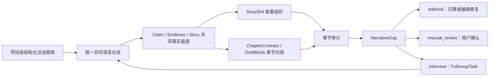

# 回忆录结构化访谈与成书补全重构规划

## 文档状态

本文档是 Pawtale 回忆录下一阶段“结构化访谈 + 成书补全重构”的规划基线，用于统一后续产品设计、数据模型、开发拆分和验收口径。

- 状态：规划基线，后续实现 PR 必须以本文为依据。
- 适用范围：回忆录项目级采集框架、引导访谈、章节审计、成书补访及其小程序体验。
- 上游事实架构：`docs/MEMOIR_NARRATIVE_ARCHITECTURE.md`。
- 上游语音架构：`docs/MEMOIR_VOICE_CHAT_REDESIGN.md`。
- 不取代：Claim、Evidence、Story、ChapterContract、DraftBlock 等叙事事实模型，也不重写 VAD、Streaming ASR、LLM/TTS 和录音状态机。
- 变更规则：如果实现证明本文的边界或约束不成立，必须先修改本文并说明证据、迁移影响和替代方案，不能通过临时 JSON、兼容分支或 Prompt 补丁绕开。

本文先固定稳定的业务边界和目标模型。精确 PR 数量可以根据实际依赖调整，但不得改变本文规定的数据真相和职责分层。

## 一、执行摘要

下一阶段不是把“成书补全”继续扩展成更大的万能完整度系统，而是建立两条职责不同、共享事实底座的业务链：

1. **结构化访谈**负责项目级采集导航，回答“人生中的哪些方面已经讲过、哪些还可以讲”。
2. **成书补全**负责章节级审校与修复，回答“当前这章为什么不好理解、缺的是新素材、编辑调整还是事实确认”。

两条链共享：

- 原始音频、Utterance 和 TranscriptVersion；
- Claim、ClaimEvidence 和 Story；
- 实时语音访谈能力；
- 已知事实、避免重复追问和隐私过滤能力。

两条链不能共享：

- 同一套覆盖状态；
- 同一套持久任务表；
- 同一种完成条件；
- “空白就必须补”的产品逻辑。

成书补全现有核心链路应保留：

```text
NarrativeGap
 -> FollowupTask
 -> VoiceSession / TaskUtterance assignment snapshot
 -> 回答用途判断
 -> Claim / Story / ChapterSourceLink / NarrativeDecision
 -> Task 与 Gap 重新评估
 -> 受影响 DraftBlock stale
 -> 章节重新审计
```

需要重构的是外围编排：

- 不再把所有章节问题都转换成访谈任务；
- 不再维护审计 Job 和确定性任务生成 Job 两套异步状态；
- 不再通过 CompletionItem、全书概览、章节工作台和小程序分别解释同一批 Gap/Task；
- 不再让“跳过一个问题”隐式排除整个 Story 和一批上下文 Claim；
- 不让未来结构化访谈框架与 StorySlot、NarrativeGap、FollowupTask 形成第四套互相同步的完整度真相。

## 二、现状与问题

### 2.1 当前已经正确建立的能力

当前实现已经具备以下长期价值，不应在重构中回退：

- Gap 是有稳定 ID、fingerprint、检测次数和处理状态的持久问题，不是一次 LLM 建议文本。
- FollowupTask 是针对 Gap 的可执行访谈动作，不等于 Gap 本身。
- FollowupTaskClaim 保存 known、do_not_repeat 和 expected_evidence 等任务语境。
- FollowupTaskUtterance 在异步处理前保存任务分配快照，避免用户换题后回答归错任务。
- 补全回答会区分直接讲述、编辑解释、事实修正和混合回答。
- 只有直接讲述进入普通叙事提取；编辑解释和事实修正走各自的应用逻辑。
- 新事实可以解决其他相关 Task/Gap，不要求用户严格只回答当前问题。
- 新回答会使受影响的 DraftBlock stale，并触发重新审计，而不是静默覆盖已确认正文。
- 小程序已经能够向用户说明回答是已入章、作为章节说明保存、仍在处理或需要确认。

这些能力承担数据回溯、事实安全和异步一致性责任，不能为了减少表数量而压平。

### 2.2 当前 guided interview 仍是 Prompt 级引导

当前 `guided_interview` 主要依赖：

```text
guidance_mode = guided_interview
current_guidance_module = person / event / place / period / theme
Prompt 中的主题菜单和追问规则
```

它能够改变 AI 的提问方式，但不能稳定回答：

- 某个项目已经覆盖了哪些人生主题；
- 某个主题由哪些 Claim 支撑；
- 用户是否明确选择不适用或接受不完整；
- 多次自由讲述是否已经补足某个主题；
- 模板升级后旧项目使用的是哪个版本。

因此结构化访谈必须引入持久项目框架，不能继续把覆盖状态放进 Prompt、会话 metadata 或前端本地状态。

### 2.3 章节问题与访谈需求混在一起

当前语义审计已经能检查：

- 本章背景和重点；
- 开头、结尾和转场；
- 人物首次出现和人物关系；
- 履历式罗列；
- 因果、指代、重复、矛盾和无来源事实。

但语义输出只表达“发现了什么 Gap”，没有表达“应该如何解决”。Planner 对大多数有关联 Story/Claim 的 Gap 都会生成 FollowupTask。

这会把以下不同问题混成同一种用户动作：

```text
缺少讲述者掌握的信息       -> 应采访
已有素材但没有写进本章     -> 应归章或调整结构
已有素材但正文表达生硬     -> 应编辑 DraftBlock
事实互相矛盾               -> 应确认或修正 Claim
用户只是不想再回答这个问题 -> 应关闭问题，不应自动排除事实
```

### 2.4 同一章节状态被多次投影

当前至少存在以下状态解释层：

1. Gap 状态；
2. FollowupTask 状态；
3. CompletionItem kind/status/action；
4. BookCompletion chapter state/action；
5. ChapterWorkspace 原始分组；
6. 小程序计算的 nextAction、readiness、方向数量和是否可生成正文。

它们不是六类独立业务事实，而是同一批 Gap、Task、Job、DraftBlock 的重复读模型。重复投影导致：

- 状态映射容易漂移；
- 小程序需要并行请求多个 API 才能判断下一步；
- 全书概览和章节工作台可能给出不同结论；
- 删除旧状态和旧 API 变得困难；
- 后续接入项目框架时容易再增加一套“统一状态”。

### 2.5 两个异步 Job 放大了状态空间

章节 Gap 审计包含 LLM 语义检查，适合异步执行；但 FollowupTask 生成是确定性数据库规划，不调用外部模型。当前把二者拆成两个 EditingJob，使用户界面必须同时判断：

- audit pending/running/succeeded/failed；
- generation pending/running/succeeded/failed；
- audit 已变化但 generation 尚未追上的中间状态。

这类中间状态没有独立产品价值，应合并为一次“刷新章节补全状态”操作，在一个 Job 内部用事务阶段隔离失败。

## 三、目标产品边界

### 3.1 四层完整性语义

系统只保留以下四层互不替代的语义：

| 层级 | 核心对象 | 回答的问题 | 是否阻塞成书 |
| --- | --- | --- | --- |
| 项目采集层 | ProjectFramework / FrameworkItem | 人生哪些方面已经讲过 | 否 |
| 故事组织层 | Story / StorySlot | 一个故事有哪些组成部分还可补充 | 否 |
| 章节审校层 | NarrativeGap | 当前章节或全书有什么逻辑、事实、来源或结构问题 | 仅 high correctness gap 可能阻塞 |
| 执行动作层 | FollowupTask | 某个 Gap 是否需要一次具体补访 | Task 本身不直接作为成书门槛 |

稳定约束：

- FrameworkItem 为空不自动创建 NarrativeGap。
- StorySlot 缺失不自动阻止已有事实成稿。
- NarrativeGap 不自动等于 FollowupTask。
- FollowupTask 完成不自动等于回答已经进入正文。
- FrameworkItem sufficient 不自动等于任何章节已经写好。
- 章节缺少框架中已有的信息时，先检查归章、Story/Claim 关联和 DraftBlock，而不是再次询问用户。



### 3.2 用户入口

项目创建时继续保留两个主要选择：

```text
自主讲述
 -> guidance_mode = free_narration
 -> 用户按自己的节奏讲
 -> 后台可以被动更新框架覆盖，但不强迫用户按框架推进

按照主题来问
 -> guidance_mode = guided_interview
 -> 展示项目级结构化访谈框架
 -> AI 每次选择一个 FrameworkItem 作为当前目标
```

成书后的补充入口继续独立存在：

```text
补全这本书
 -> session_goal = book_completion
 -> 只消费真正需要讲述者输入的 FollowupTask
```

`guidance_mode` 表达交互强度，`session_goal` 表达业务目标。两者不能复用同一字段。

## 四、目标数据模型

### 4.1 继续作为共同事实底座的对象

```text
AudioFile
MemoirVoiceSession
MemoirVoiceUtterance
MemoirTranscriptVersion
MemoirClaim
MemoirClaimEvidence
MemoirStory
MemoirStoryClaim
MemoirStorySlot
MemoirChapterContract
MemoirDraftBlock
```

结构化访谈和成书补全只能通过这些对象共享事实，不能互相读取对方的内部状态来推断内容真相。

### 4.2 项目级结构化访谈模型

第一版模板使用后端版本化定义，不建设可在线编辑的模板后台。

```text
FrameworkTemplateDefinition        # Python/Pydantic 版本化定义，不是数据库表
  template_key
  version
  modules[]
  items[]
    item_key
    module_key
    title
    intent
    evidence_hints
    sufficiency_policy
    sort_order

MemoirProjectFramework
  id
  project_id                       # 第一版每项目一个当前框架
  template_key
  template_version
  created_at
  updated_at

MemoirFrameworkItem
  id
  project_id
  project_framework_id
  item_key                         # 来自指定模板版本
  module_key                       # person/event/place/period/theme 或后续版本定义
  sort_order
  coverage_status                  # not_started / has_material / sufficient / accepted_incomplete / not_applicable
  assessment_summary
  user_resolution_note
  resolution_actor_type
  resolved_by_user_id
  resolved_at
  deferred_until                   # 只影响下一项选择，不改变 coverage_status
  defer_reason
  updated_at

MemoirFrameworkItemClaim
  project_id
  framework_item_id
  claim_id
  evidence_role                    # supports / contradicts
  created_at
```

模型约束：

- `item_key` 必须来自 `template_key + template_version` 的版本化定义。
- 模板升级必须显式迁移，不能在读取时静默套用新模板。
- coverage status 必须由 Claim 关系、规则评估和用户 resolution 共同决定。
- AI 重算不能覆盖 `accepted_incomplete` 或 `not_applicable` 等人工决定。
- “以后再补”通过 `deferred_until/defer_reason` 表达，不能伪装成覆盖状态；到期后 item 仍按原 coverage status 参与选择。
- FrameworkItem 不直接关联 Chapter、NarrativeGap 或 FollowupTask。
- 第一版不创建 Question 表；问题由模板意图、当前 Claim 和最近对话动态生成。
- 第一版不创建 FrameworkItemStory 表；需要 Story 时通过 FrameworkItemClaim -> StoryClaim 推导，避免重复关系。

### 4.3 NarrativeGap 增加解决通道

在 Gap 层增加受控字段：

```text
recommended_action
  interview
  editorial
  manual_review
```

含义：

- `interview`：缺少讲述者掌握的信息，可以生成 FollowupTask。
- `editorial`：已有事实基本足够，应调整归章、结构节点或 DraftBlock。
- `manual_review`：需要用户确认事实、人物、时间、来源或收录决定，不适合自动改写。

约束：

- `recommended_action` 是问题的解决通道，不替代 Gap status。
- 它不进入 Gap fingerprint；同一个稳定问题改变解决方式时仍是同一个 Gap。
- 只有 `interview` 可以自动创建或保持 active FollowupTask。
- 已经 in_progress 的 Task 不因审计重算而在用户回答过程中被切换通道。
- `editorial` 修复完成后仍需重新审计才能解决 Gap。
- `manual_review` 不得通过继续采访自动绕过用户确认。

### 4.4 FollowupTask 保持独立

FollowupTask 继续表达一次可执行补访，并保留：

```text
gap_id
chapter_id
story_id
target_slot
answer_use
question
purpose
known_context_summary
priority
status
assigned_session_id
```

不把 FrameworkItem 合并进 FollowupTask，原因是：

- FrameworkItem 是长期覆盖导航，可以被多次会话持续补充；
- FollowupTask 是某个 Gap 的一次处理动作，Gap 变化后可能取消或解决；
- FrameworkItem 的 sufficient 不等于章节问题解决；
- FollowupTask 的 answered 不等于某个人生主题充分覆盖。

### 4.5 VoiceSession 的目标绑定

新增：

```text
current_framework_item_id  # optional
```

保留：

```text
current_followup_task_id   # optional
```

数据库和 schema 约束：

- 两者最多一个非空。
- `current_followup_task_id` 只允许 `session_goal=book_completion`。
- `current_framework_item_id` 只允许 `session_goal=open_narration` 且 `guidance_mode=guided_interview`。
- `current_guidance_module` 在迁移期可以保留为 UI/Prompt 辅助字段，但不再作为覆盖状态真相。
- FrameworkItem 完成切流后，如果 `current_guidance_module` 不再有独立交互价值，应删除而不是永久双写。
- 不引入无外键约束的 `target_type + target_id` 万能多态字段。

### 4.6 共享 InterviewBrief，而不是共享任务表

语音编排层使用统一的只读 DTO：

```text
InterviewBrief
  source_kind              # framework / book_completion
  target_id
  purpose
  opening_question
  known_claims
  do_not_repeat_claims
  expected_evidence_hint
  completion_policy
```

`InterviewBrief` 不持久化，只负责把不同业务目标转换成语音系统能消费的上下文。

- FrameworkItem adapter 从模板定义、item claims 和 coverage status 生成 brief。
- FollowupTask adapter 从 task claims、answer use 和 pending confirmation 生成 brief。
- Voice assistant 只消费 brief，不直接查询 FrameworkItem 或 FollowupTask 的内部表结构。

## 五、成书补全目标重构

### 5.1 统一刷新操作

将以下两步合并：

```text
RECOMPUTE_CHAPTER_STRUCTURE_AUDIT
GENERATE_FOLLOWUP_TASKS
```

目标流程：

```text
RefreshChapterCompletion Job
 -> 加载 ChapterAuditContext
 -> 确定性规则审计
 -> LLM 语义审计
 -> upsert/reconcile Gap
 -> 根据 recommended_action 确定性规划 FollowupTask
 -> 提交当前 Gap/Task 状态
 -> 由唯一 query service 按当前事实构造 ChapterCompletionSummary
```

实现约束：

- 外部 LLM 调用前不得长期持有 SQLite writer lock。
- Planner 阶段使用 savepoint；Planner 失败不能破坏已完成的 Gap 审计结果。
- 一个 Job 只暴露一套 pending/running/succeeded/failed 状态。
- Job result 分别记录 audit 和 planner 阶段结果，便于诊断。
- 删除独立 `GENERATE_FOLLOWUP_TASKS` handler、failure event 和 generation API。

### 5.2 统一 ChapterCompletionSummary

后端提供唯一章节补全读模型：

```text
ChapterCompletionSummary
  chapter_id
  state
  audit_status
  audit_is_current
  next_action
  must_handle_count
  suggested_count
  accepted_incomplete_count
  active_task
  visible_tasks[]           # 最多三项
  editorial_gaps[]
  review_gaps[]
  draft_readiness
  headline
  detail
```

`ChapterCompletionSummary` 第一版只作为查询响应/应用层 DTO，不新增持久 snapshot 表。只有出现经过测量的真实性能瓶颈，并且具备明确失效机制时，才重新评估是否需要缓存。

建议的 next action：

```text
create_direction
confirm_direction
refresh_audit
wait
continue_confirmation
start_interview
open_editorial_fix
open_manual_review
generate_draft
review_draft
complete
```

消费方式：

- 全书补全概览读取 summary 的精简字段。
- 章节工作台读取同一个 summary 加详细列表。
- 小程序不再根据多个 API 的原始状态重新实现业务优先级。
- DraftBlock 详情仍可独立分页或按需读取，不要求把全文塞进 summary。

完成切流后删除：

- CompletionItem schema/service/enums；
- BookCompletionAction；
- prepare API 中小程序不使用的完整 response；
- 小程序 `chapterNextAction` 中与后端重复的业务判断。

### 5.3 明确用户动作语义

补访任务提供以下动作：

```text
换一个
想不起来 -> accepted_incomplete 或 ask_family_later
以后再说 -> deferred
不再问这个问题 -> 关闭 Task，不修改 Story/Claim publication
```

内容收录决定移出 Task 控件：

```text
整个故事不收录 -> Story publication decision + 独立确认
某条事实不收录 -> Claim publication decision + 独立确认
章节不收入本书 -> Chapter include_in_book decision
```

不得从 FollowupTaskClaim 的 known/do_not_repeat 关系推导要排除的 Claim 范围。

### 5.4 Gap 关系的后续收敛

当前 Gap 同时保存 `primary_story_id/primary_chapter_id` 和 role=primary 的关系行。完成行为重构后再进行数据迁移：

- `primary_*` 是 scope 的唯一权威字段；
- GapStory/GapChapter 只保存额外 involved 对象；
- API 需要完整关系列表时动态组合；
- 迁移前校验两套关系一致性；
- 不把此迁移与 recommended_action 或 Job 重构放在同一 PR。

## 六、端到端业务流程

### 6.1 按照主题来问

```text
创建 guided_interview 项目
 -> 初始化 ProjectFramework 和 FrameworkItem
 -> 用户看到模块和当前可讲方向
 -> Planner 选择一个未充分覆盖且未被人工跳过的 item
 -> 创建 open_narration VoiceSession + current_framework_item_id
 -> Framework adapter 生成 InterviewBrief
 -> 复用实时 ASR / LLM / TTS 访谈
 -> Utterance 正常进入 Claim / Story ingestion
 -> Framework evaluator 关联新 Claim 并更新 coverage status
 -> 用户看到“已经讲到什么”和下一项建议
```

完成条件不是“回答过一次”，而是存在足够、可追溯且未被排除的 Claim；具体 sufficient 规则由模板版本定义和评估器共同决定。

### 6.2 自主讲述

```text
创建 free_narration 项目
 -> 不绑定 FrameworkItem
 -> 用户自由讲述
 -> Utterance 正常进入 Claim / Story ingestion
 -> 后台将新 Claim 被动匹配到 FrameworkItem
 -> 不打断当前叙述，不自动切换为强引导
```

自由讲述可以提高框架覆盖，但框架不能反过来约束用户的叙述顺序。

### 6.3 成书补全

```text
用户进入全书补全概览
 -> 后端读取各章 ChapterCompletionSummary
 -> 用户选择一章
 -> 如果 audit stale，触发 RefreshChapterCompletion Job
 -> Gap 按 recommended_action 分流
    -> editorial：打开章节编辑/局部重写
    -> manual_review：打开确认界面
    -> interview：展示最多三个 FollowupTask
 -> 用户选择一个 Task
 -> 创建 book_completion VoiceSession + current_followup_task_id
 -> FollowupTask adapter 生成 InterviewBrief
```

### 6.4 补全回答后的闭环

```text
用户回答
 -> 先保存 Utterance 与 TranscriptVersion
 -> 使用 TaskUtterance assignment snapshot 锁定原任务
 -> 判断 direct_narrative / clarification / fact_resolution / mixed
 -> direct_narrative 进入 Claim / Story ingestion
 -> clarification 进入章节编辑上下文
 -> fact_resolution 更新事实决策或进入用户确认
 -> 只在满足对应完成条件时将 Task 标记 answered
 -> 重新评估 Gap
 -> 标记受影响 DraftBlock stale
 -> 重新运行章节补全刷新
 -> CompletionOutcome 告诉用户实际结果
```

用户可观察结果必须区分：

- 已收入某章素材；
- 已作为章节说明保存；
- 已完成事实修正；
- 需要进一步确认；
- 已保存但仍在处理；
- 未作为书稿素材使用。

## 七、两条业务链的结合规则

### 7.1 允许的共享

- FrameworkItem 和 FollowupTask 都可以引用 Claim 作为已知上下文。
- 两者都复用 InterviewBrief、VoiceSession、ASR、TTS 和对话 UI。
- 新 Utterance 的 Claim 可以同时提高一个 FrameworkItem 覆盖，并解决一个已有 Gap。
- Prompt 生成都必须过滤 private、excluded、rejected 和 superseded Claim。
- 两者都可以使用 do_not_repeat 语义，但来源和完成规则分别维护。

### 7.2 禁止的耦合

- 不因为 FrameworkItem not_started 就创建 Gap 或 FollowupTask。
- 不因为 FrameworkItem sufficient 就自动解决章节 Gap。
- 不把 FollowupTask answered 写成 FrameworkItem sufficient。
- 不把 Chapter ID 存进 FrameworkItem 作为固定归章目标。
- 不把模板 item 预先展开成固定问题记录。
- 不让结构化访谈成为正式成书门槛。
- 不建设包含 framework/gap/task/story_slot 的万能 requirement 表。

### 7.3 现有素材优先策略

当章节审计发现缺少背景、人物说明、转场或结尾时，按以下顺序处理：

1. 检查本项目是否已经存在相关 Claim/Story。
2. 检查素材是否只是未归入本章或未绑定当前节点。
3. 检查 DraftBlock 是否 stale 或没有使用已有 Claim。
4. 如果已有素材足够，创建/保持 editorial Gap，不生成访谈任务。
5. 只有明确缺少讲述者掌握的信息时，才创建 interview Gap 和 FollowupTask。

Framework coverage 可以作为查找已有材料的导航信号，但 Claim/Evidence 才是是否已有事实的最终依据。

## 八、小程序目标体验

### 8.1 结构化访谈页

用户看到的是可理解的主题框架，而不是数据库状态：

```text
已经讲过
还可以继续讲
以后再补
不适合我的经历
```

要求：

- 不展示伪精确覆盖百分比；
- 每次只突出一个建议方向，但允许用户自行换模块；
- 显示已知内容的简短摘要，避免重复询问；
- 用户可以接受不完整或标记不适用；
- 框架模块不是章节目录，不能让用户误以为每个模块都会生成一章。

### 8.2 成书补全页

全书概览继续按章节展示，但明确区分：

- 需要补讲；
- 需要确认；
- 可以由系统重新整理；
- 当前不需要处理。

章节工作台只突出一个 next action，同时允许用户查看最多三个补讲方向。编辑问题不得伪装成需要老人继续录音的问题。

### 8.3 动作安全

- “不再问”不能改变书稿收录范围。
- “不收录故事/事实/章节”必须显示准确影响范围并单独确认。
- “想不起来”不得显示成“已确认事实”。
- “回答已保存”不能等同于“已入章”。
- 任何失败提示都必须说明录音、转写和已有正文是否受到影响。

## 九、迁移与兼容策略

### 9.1 新框架采用增量迁移

- 新增 ProjectFramework、FrameworkItem、FrameworkItemClaim 表。
- 所有新回忆录项目初始化同一版本化框架；`guidance_mode` 只决定是否主动按框架导航。
- free_narration 项目保留框架用于后台覆盖匹配，但不绑定当前 item、不主动切换主题。
- 现有 guided_interview 项目在用户首次进入框架页时显式初始化。
- 现有 free_narration 项目在首次需要展示框架或运行覆盖回填时显式初始化。
- 初始化后用现有有效 Claim 做一次 coverage backfill。
- 不修改原始音频、Utterance、TranscriptVersion、Claim 或 Story ID。
- 模板升级只通过显式 migration，不在读路径自动生成缺失 item。

### 9.2 现有 Gap/Task 保守迁移

为现有 Gap 回填 recommended_action 时采用保守规则：

- 已存在 active FollowupTask 的 Gap 先标为 interview，避免中断正在回答的任务；
- repetition 默认 editorial；
- 没有 active Task 且无法确定是否需要新证据的 Gap 默认 manual_review；
- 迁移后重新审计可以改变 recommended_action，但不能覆盖人工 resolution。

### 9.3 API 删除顺序

以下 API 只有在小程序和其他已知客户端完成切流后才能删除：

- 独立 followup task generation job API；
- 小程序未使用的 prepare response action；
- 独立 resume/cancel endpoint 候选。

删除前必须：

1. 全仓搜索生产调用；
2. 检查 OpenAPI/外部调用记录；
3. 用新流程覆盖现有测试；
4. 删除对应 schema、service、handler、event 和文档，不保留永久兼容壳。

## 十、测试与可观测性

### 10.1 必须覆盖的业务回归

- FrameworkItem 只能由有效 Claim 或人工决定改变覆盖状态。
- 自由讲述可以更新框架，但不会打断用户或自动开始强引导。
- 一个 FrameworkItem 可由多次会话逐步补足。
- FrameworkItem accepted_incomplete/not_applicable 不会被 AI 重算覆盖。
- 框架空白不会创建 Gap/Task，也不会阻塞成书。
- 已有素材足够的开头/转场问题走 editorial，不生成重复访谈。
- 只有 recommended_action=interview 的 Gap 生成 active Task。
- “不再问”不会修改 Story/Claim publication。
- 明确排除 Story/Claim 时只影响用户确认的目标。
- TaskUtterance snapshot 在换题、异步 ingestion 和跑题情况下仍能正确归属。
- 直接讲述、编辑解释、事实修正和 mixed 回答保持不同落库行为。
- 补全回答后只标记实际依赖它的 DraftBlock stale。
- 全书概览和章节工作台对同一章节返回一致的状态和 next action。
- 修改章节内容后旧 audit 不会被错误当作 current。
- 模板版本升级和 Gap 关系迁移通过 SQLite schema/外键完整性检查。

### 10.2 评估样本

至少保留以下脱敏真实风险样本：

- 同一事件在多个章节重复出现；
- 用户只想一笔带过的次要事件；
- 开头突兀但项目中已有足够背景素材；
- 人物关系已在其他会话讲清但本章遗漏；
- 用户回答补全问题时跑题并讲出另一个重要故事；
- 澄清回答不应该直接进入正文；
- 事实修正需要确认后才能修改 Claim；
- 同一框架主题经过多次自由讲述逐步补齐；
- 用户明确不适用某个框架主题；
- 用户只跳过一个问题，不排除已有故事。

### 10.3 可观测指标

建议记录以下不含原始敏感文本的指标：

- framework item 的状态迁移数量和来源；
- guided session 选中 item 后产生有效 Claim 的比例；
- 同一 item/Story 的重复追问率；
- Gap 按 interview/editorial/manual_review 的分布；
- FollowupTask 从创建到 answered/accepted_incomplete 的耗时；
- 回答保存到 incorporated/context_recorded/needs_confirmation 的耗时；
- 章节 refresh job 的各阶段耗时和失败阶段；
- 全书概览与章节工作台 summary 版本不一致次数，目标为 0。

不得把原始音频、完整转写或敏感 Claim 文本放进指标标签和普通日志。

## 十一、建议开发阶段

### 阶段 A：先修正成书补全语义

#### A1：拆分“跳过问题”和“排除内容”

- 新增不修改 publication 的 skip/stop-asking 动作。
- Story/Claim 排除使用独立 endpoint 和确认语义。
- 增加语义 Gap 引用 known Claim 时的回归测试。

验收：跳过一个补访问题后，关联 Story/Claim 仍可正常进入其他章节和正文。

#### A2：Gap recommended_action

- 增加字段、枚举、迁移和审计输出。
- Planner 只为 interview Gap 创建 Task。
- editorial/manual_review 在章节工作台有明确入口。

验收：至少用“已有背景但开头突兀”和“确实缺少背景”两个样本证明分流不同。

### 阶段 B：收敛补全读模型和 Job

#### B1：ChapterCompletionSummary

- 后端统一 summary 和 next action。
- 全书概览、章节工作台切换到同一读模型。
- 小程序删除重复业务判断。

验收：相同数据库状态下两个页面展示的章节结论一致。

#### B2：合并 refresh job 并清理外围代码

- 合并 audit + deterministic planner。
- 删除 Followup generation job、CompletionItem 和未使用 action/API。
- 批量读取章节 summary，消除按章顺序 N+1。

验收：Job 状态只剩一套；原有补访、失败重试和内容变化重新审计测试全部通过。

### 阶段 C：建立项目级结构化访谈框架

#### C1：模板与持久模型

- 定义第一版模板 schema。
- 新增 ProjectFramework、FrameworkItem、FrameworkItemClaim。
- 初始化、版本校验、人工 resolution 和 backfill。

验收：新旧 guided 项目都能获得可追溯、可升级的框架状态。

#### C2：Coverage evaluator

- 使用 Claim/Evidence 评估 has_material/sufficient。
- 保护人工 accepted_incomplete/not_applicable。
- 自由讲述 ingestion 后异步更新相关 item。

验收：同一 item 可由多次会话补足，且无 Claim 时不能被 AI 文案标为 sufficient。

### 阶段 D：接入统一语音编排和小程序

#### D1：InterviewBrief 与 session binding

- 新增 current_framework_item_id 和互斥约束。
- Framework/Followup 两个 adapter 输出统一 brief。
- Voice assistant 从 brief 构建 Prompt。

验收：两种访谈复用同一 ASR/TTS/UI，但完成条件和持久状态互不污染。

#### D2：结构化访谈 UI

- 项目创建选择与框架入口联动。
- 模块概览、当前方向、换方向、接受不完整和不适用。
- 自由讲述只显示非强制的后台覆盖结果。

验收：用户能够理解“已讲过什么、接下来可以讲什么”，且不会误解为章节目录或成书硬门槛。

### 阶段 E：数据关系与性能收尾

- 收敛 Gap primary/involved 关系。
- 补齐 summary、review event 和 Job 查询索引/直接关联。
- 删除确认无客户端使用的 resume/cancel 兼容 API。
- 更新两份上游架构文档的已实现状态。

验收：迁移完整性、查询数量、OpenAPI 和全仓死代码检查通过。

## 十二、规划门禁与完成定义

每个后续 PR 必须说明：

1. 属于本文哪个阶段和边界；
2. 修改了哪一个业务真相，是否引入新状态；
3. 为什么不能通过现有模型表达；
4. 数据迁移和回滚方式；
5. 用户可观察行为变化；
6. 真实风险回归样本；
7. 是否更新本文或上游架构文档。

任何实现不得以以下方式宣称完成：

- 只新增 Prompt 文案，没有持久状态和证据关系；
- 只让 UI 显示新状态，后端仍由客户端拼接业务结论；
- 只创建新表，同时保留旧状态永久双写；
- 通过框架覆盖率或 StorySlot 缺失阻止已有真实内容成书；
- 用户回答已保存，但系统无法说明是否入章、作为说明保存或仍待确认；
- 为了复用而创建跨 framework/gap/task 的万能模型。

整体完成标准：

- 结构化访谈能够稳定指导项目级采集；
- 自由讲述和结构化访谈沉淀到同一 Claim/Story 底座；
- 成书补全只在确实需要新信息时询问用户；
- 编辑问题、事实确认和补访问题有不同动作；
- 全书概览和章节工作台共享唯一后端读模型；
- 每次补全回答都能向用户解释真实去向；
- 核心事实、音频和用户决策在所有重构中保持可追溯。

## 十三、待产品确认但不阻塞底层重构的问题

以下问题需要在阶段 C/D 开始前确认，但不影响阶段 A/B：

1. 第一版框架的具体模块和 item 内容，以及是否采用“人生阶段 + 人物/事件/地点/主题”混合导航。
2. sufficient 是否完全由系统评估，还是允许用户显式确认“这一项已经讲够了”。
3. 模板升级是否只影响新项目，还是给旧项目提供用户主动升级入口。
4. 自由讲述用户是否默认看到框架进度，还是只在主动切换到“按照主题来问”时展示。
5. 框架模块的用户文案是否按不同年龄、家庭角色或回忆录类型提供变体。

在这些问题确定前，可以完成成书补全语义修正、统一 summary、Job 合并和核心框架引擎；不得提前把某套产品文案硬编码成不可升级的数据结构。
